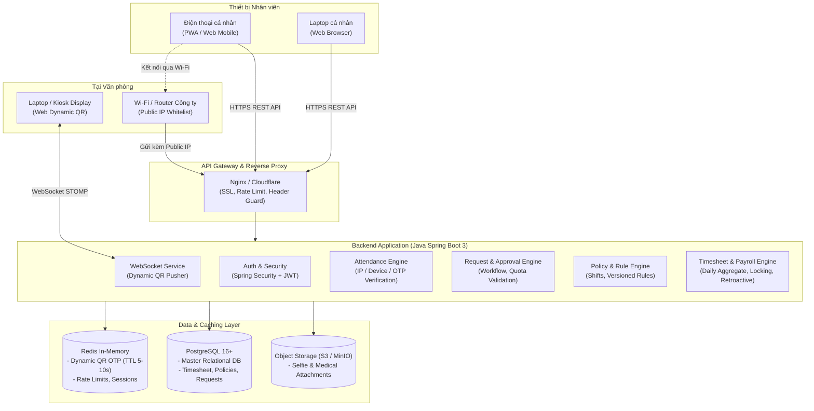
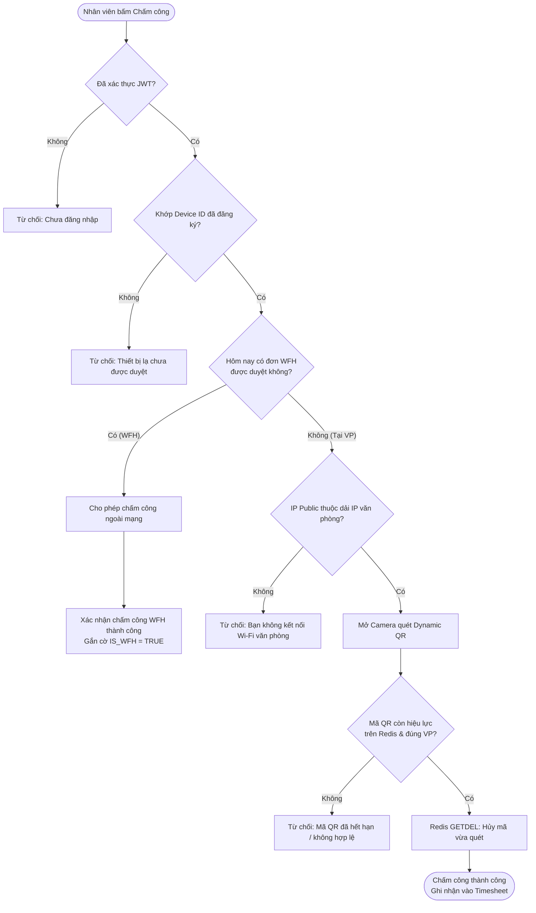

# TÀI LIỆU 00: TỔNG QUAN KIẾN TRÚC & GIẢI PHÁP HỆ THỐNG
## Hệ thống Chấm công Online & Quản lý Đơn từ Nội bộ (Smart Attendance & Leave Management)

---

## 1. MỤC TIÊU HỆ THỐNG
1. **Xác thực vị trí thực tế & Chống gian lận:** Đảm bảo nhân viên có mặt tại văn phòng bằng phương thức xác thực đa lớp (Dynamic QR Code + Wi-Fi Public IP + Device Binding), loại bỏ triệt để hành vi chấm công hộ, giả lập vị trí.
2. **Linh hoạt & Dự phòng:** Cung cấp cơ chế chấm công dự phòng (Selfie khẩn cấp) khi mất điện/mất mạng và cơ chế chấm công linh hoạt cho nhân viên làm việc từ xa (WFH) khi có đơn được duyệt.
3. **Quản lý Đơn từ & Hạn ngạch (Quota) chặt chẽ:** Tự động kiểm soát các loại đơn (đi muộn/về sớm, quên chấm công, nghỉ phép, nghỉ BHXH, WFH) theo từng loại hợp đồng và phòng ban.
4. **Độ tin cậy & Tính toàn vẹn dữ liệu lương:** Dữ liệu chấm công đi thẳng vào bảng lương; quy trình chốt công 4 bước, khóa dữ liệu bất biến và xử lý hồi tố kỳ sau (không sửa ngược kỳ đã khóa).

---

## 2. KIẾN TRÚC HỆ THỐNG TỔNG THỂ (SYSTEM ARCHITECTURE)

---

## 3. CÔNG NGHỆ ÁP DỤNG (TECH STACK)

| Thành phần | Công nghệ lựa chọn | Lý do lựa chọn |
| :--- | :--- | :--- |
| **Backend Framework** | **Java 21 LTS + Spring Boot 3.3+** | Chuẩn doanh nghiệp, bảo mật cao, hỗ trợ transaction toàn vẹn cho bảng lương. |
| **Bảo mật & Phân quyền** | **Spring Security 6 + JJWT / Nimbus** | Phân quyền RBAC đa cấp (Employee, Team Lead, Dept Head, HR, Admin). |
| **Giao tiếp Real-time** | **Spring WebSocket + STOMP** | Đồng bộ mã Dynamic QR xuống màn hình hiển thị mỗi 5–7 giây. |
| **In-Memory Cache** | **Redis 7.x** | Quản lý mã OTP quét QR (TTL ngắn), kiểm tra atomic `GETDEL` chống Replay Attack. |
| **Cơ sở dữ liệu chính** | **PostgreSQL 16+** | Hỗ trợ JSONB cho cấu hình luật linh hoạt, transaction an toàn (ACID), hiệu năng cao. |
| **Lưu trữ tệp tin** | **Amazon S3 / MinIO** | Lưu trữ ảnh chụp selfie dự phòng, giấy khám ốm đau BHXH mẫu C65-HD. |
| **Frontend Web/PWA** | **Next.js 14 / React + TailwindCSS** | Giao diện Responsive cho cả Desktop (HR) và Mobile (Nhân viên), hỗ trợ PWA offline-first shell. |
| **Thư viện Web Camera/QR** | **html5-qrcode / @zxing/library** | Quét trực tiếp từ luồng Camera trình duyệt, chặn hành vi chọn file ảnh tải lên. |
| **Định danh thiết bị** | **FingerprintJS Pro / Native Web Crypto Token** | Kết hợp Hardware Fingerprint + UUID lưu an toàn tại IndexedDB để chống đổi máy. |

---

## 4. CHIẾN LƯỢC BẢO MẬT & XÁC THỰC ĐA LỚP (MULTI-FACTOR CHECK-IN)

---

## 5. BỘ TÀI LIỆU ĐẶC TẢ CHI TIẾT ĐÍNH KÈM
Hệ thống được bóc tách thành các tài liệu chi tiết chuyên sâu:
* **[Tài liệu 01: Phân hệ Ghi nhận Chấm công & Chống gian lận](file:///Users/sang/.gemini/antigravity/brain/e77846b6-07ff-4ad4-b626-aa4ca40da8e8/01_MODULE_ATTENDANCE_CHECKIN.md)**
* **[Tài liệu 02: Phân hệ Quản lý Đơn từ, Nghỉ phép & WFH](file:///Users/sang/.gemini/antigravity/brain/e77846b6-07ff-4ad4-b626-aa4ca40da8e8/02_MODULE_REQUESTS_LEAVE_WFH.md)**
* **[Tài liệu 03: Phân hệ Cấu hình Luật, Ca làm việc & Hạn ngạch](file:///Users/sang/.gemini/antigravity/brain/e77846b6-07ff-4ad4-b626-aa4ca40da8e8/03_MODULE_POLICY_RULE_ENGINE.md)**
* **[Tài liệu 04: Phân hệ Tổng hợp, Chốt công, Khiếu nại & Hồi tố](file:///Users/sang/.gemini/antigravity/brain/e77846b6-07ff-4ad4-b626-aa4ca40da8e8/04_MODULE_TIMESHEET_PAYROLL_CLOSING.md)**
* **[Tài liệu 05: Thiết kế Cơ sở Dữ liệu Chi tiết (Database Schema)](file:///Users/sang/.gemini/antigravity/brain/e77846b6-07ff-4ad4-b626-aa4ca40da8e8/05_DATABASE_SCHEMA_DESIGN.md)**
