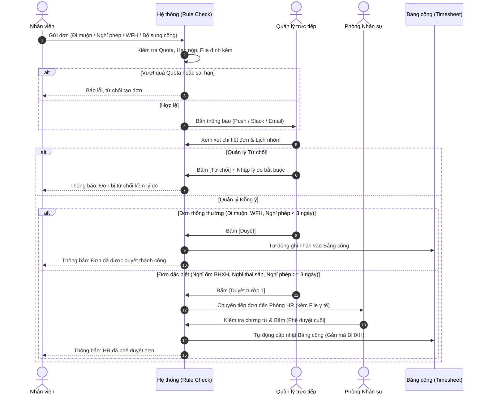

# TÀI LIỆU 02: ĐẶC TẢ PHÂN HỆ QUẢN LÝ ĐƠN TỪ, NGHỈ PHÉP & WFH
## Phân hệ 2 (Sections 6.2, 6.3, 6.4, 6.5, 6.6)

---

## 1. TỔNG QUAN PHÂN HỆ
Phân hệ Đơn từ cho phép nhân viên gửi các yêu cầu điều chỉnh công và xin vắng mặt có kiểm soát. Tất cả các loại đơn đều được **ràng buộc tự động bằng hạn ngạch (Quota)**, kiểm tra tính hợp lệ ngay lúc tạo đơn và đi qua quy trình phê duyệt nghiêm ngặt trước khi cập nhật vào bảng công.

---

## 2. ĐẶC TẢ CHI TIẾT TỪNG LOẠI ĐƠN

### 2.1. Đơn Đi muộn / Về sớm (Section 6.2)
* **Mục đích:** Hợp thức hóa việc đi muộn hoặc về sớm vì lý do cá nhân trong giới hạn cho phép của công ty mà không bị trừ phạt.
* **Cấu hình Quota (HR thiết lập theo Loại Hợp đồng / Phòng ban):**
  * *Số lần tối đa / tháng:* Mặc định 2 lần/tháng.
  * *Thời lượng tối đa / lần:* Mặc định 60 phút/lần.
  * *Ví dụ phân loại:* Nhân viên thử việc: 1 lần/tháng, tối đa 30 phút. Nhân viên chính thức: 2 lần/tháng, tối đa 60 phút.
* **Giao diện tạo đơn của Nhân viên:**
  * Hiển thị số lượt còn lại theo thời gian thực: *"Bạn đã sử dụng 1/2 lượt trong tháng [MM/YYYY]. Còn lại: 1 lượt"*.
  * Chọn loại: Đi muộn (Late In) hoặc Về sớm (Early Out).
  * Nhập số phút dự kiến (nếu nhập > 60 phút $\rightarrow$ Báo lỗi không cho gửi).
  * Bắt buộc nhập lý do.
* **Tác động vào Bảng công khi được duyệt:**
  * Khoảng thời gian đi muộn/về sớm nằm trong đơn hợp lệ sẽ **không bị tính là vi phạm kỷ luật** và không bị trừ lương theo thang phạt.

---

### 2.2. Đơn Bổ sung Chấm công (Section 6.3)
* **Mục đích:** Xử lý trường hợp quên chấm công vào/ra hoặc gặp sự cố kỹ thuật.
* **Ràng buộc nghiệp vụ (Business Rules):**
  * **Hạn nộp đơn (Deadline):** Chỉ được nộp trong vòng **3 ngày làm việc** kể từ ngày phát sinh lỗi quên chấm công. Sau 3 ngày, ngày đó bị khóa vĩnh viễn (trừ trường hợp đặc biệt do HR mở quyền).
  * **Hạn mức (Quota):** Tối đa **3 lần / tháng**. Vượt quá quota không thể tạo thêm đơn.
* **Dữ liệu đơn yêu cầu:**
  * Chọn ngày bị thiếu công.
  * Chọn mốc thời gian bổ sung: Bổ sung giờ VÀO, bổ sung giờ RA, hoặc cả hai.
  * Nhập thời gian thực tế: Ví dụ: `08:35` và `17:35`.
  * Bắt buộc nhập lý do chi tiết (kèm bằng chứng nếu có, ví dụ ảnh chụp màn hình tin nhắn trao đổi công việc lúc sáng).
* **Luồng duyệt:** Quản lý trực tiếp duyệt $\rightarrow$ Tự động cập nhật giờ chấm công vào bảng công ngày tương ứng.

---

### 2.3. Đơn Nghỉ phép & Nghỉ chế độ (Section 6.4)
Hệ thống phân tách rõ 3 nhóm tài chính để phục vụ kế toán lương:

| Loại nghỉ | Nguồn chi trả | Đơn vị | Quy tắc & Hạn mức | Chứng từ bắt buộc |
| :--- | :--- | :--- | :--- | :--- |
| **Phép năm (Annual Leave)** | Công ty trả | Ngày / Nửa ngày | 12 ngày/năm. Thâm niên: **+1 ngày mỗi 2 năm làm việc**. Trừ trực tiếp vào quỹ phép còn lại. | Không |
| **Nghỉ ốm (Sick Leave)** | Công ty chi trả | Ngày | Tối đa theo quy chế nội bộ công ty. | **Bắt buộc tải Giấy khám / Đơn thuốc y tế** |
| **Nghỉ Thai sản (Maternity)** | **BHXH chi trả** | Theo chế độ | 6 tháng đối với nữ sinh con; nam nghỉ 5–14 ngày theo Luật BHXH. | **Bắt buộc Giấy ra viện / Giấy khai sinh** |
| **Nghỉ Hiếu / Hỉ** | Công ty trả | Ngày | Kết hôn: 3 ngày; Con kết hôn: 1 ngày; Tứ thân phụ mẫu/vợ/chồng/con mất: 3 ngày. | Giấy đăng ký kết hôn / Giấy báo tử |
| **Nghỉ không lương (Unpaid)** | Không chi trả | Ngày / Nửa ngày | Cần Quản lý và HR đồng thuận. Tối đa theo quy chế. | Không |

#### Quy tắc Quản lý Quỹ phép năm (Leave Accrual):
* **Cộng dồn tự động:** Mỗi tháng làm việc đủ tiêu chuẩn được cộng 1 ngày phép vào ngày 01 hàng tháng (hoặc cộng đủ 12 ngày vào đầu năm theo cấu hình).
* **Phép tồn (Carry-over):** Số phép chưa dùng hết trong năm cũ được phép chuyển sang năm sau sử dụng đến hết ngày **31/03** năm kế tiếp. Sau ngày này, hệ thống tự động reset phép tồn về 0.

---

### 2.4. Đăng ký Làm việc Từ xa (Work From Home - WFH) (Section 6.5)

* **Hình thức đăng ký:**
  1. *Đăng ký lẻ (Ad-hoc):* Chọn ngày cụ thể hoặc nửa ngày (sáng/chiều).
  2. *Đăng ký lịch cố định (Recurring Schedule):* Cấu hình ngày lặp lại hàng tuần (ví dụ: Thứ Sáu hàng tuần).
* **Quota & Điều kiện áp dụng:**
  * Quota cấu hình theo Phòng ban / Vị trí: Ví dụ IT được tối đa 1 ngày/tuần (hoặc 4 ngày/tháng); Sales/Lễ tân: 0 ngày/tháng (bị vô hiệu hóa tính năng).
* **Thời hạn nộp đơn:**
  * Bắt buộc nộp trước **ít nhất 1 ngày làm việc** (trước 17:00 ngày hôm trước).
  * *Ngoại lệ đơn gấp (Urgent WFH):* Nếu nộp trong ngày hoặc sau 17:00, hệ thống vẫn cho phép nộp nhưng tự động gắn nhãn cờ vàng cảnh báo: `[ĐƠN WFH GẤP]` gửi cho Quản lý.
* **Cơ chế Chấm công ngày WFH:**
  * Mở quyền cho nhân viên chấm công ngoài mạng IP công ty vào ngày WFH đã duyệt.
* **Báo cáo cuối ngày (EOD Report - Tùy chọn cấu hình):**
  * Trước 18:30 ngày WFH, nhân viên mở web điền form ngắn: *"Tóm tắt 3 kết quả công việc đã hoàn thành trong ngày"*. Báo cáo đính kèm vào bảng công ngày WFH.

---

## 3. LỊCH NHÓM DÙNG CHUNG (TEAM CALENDAR VIEW)
Dành cho Trưởng nhóm / Trưởng phòng để quản lý nguồn lực trước khi duyệt đơn:
* **Giao diện:** Dạng Gantt Chart hoặc Lịch tuần/tháng.
* **Hiển thị trực quan:**
  * Màu xanh dương: Đi làm tại văn phòng.
  * Màu tím: Đang WFH.
  * Màu cam: Nghỉ phép năm.
  * Màu xám: Nghỉ không lương / Nghỉ chế độ.
* **Cảnh báo xung đột nguồn lực:** Nếu trong ngày có hơn **30% nhân sự trong team** cùng đăng ký WFH hoặc nghỉ phép, hệ thống hiện cảnh báo đỏ: *"Cảnh báo: Tỷ lệ vắng mặt tại văn phòng vượt ngưỡng 30%"*.

---

## 4. QUY TRÌNH DUYỆT ĐƠN ĐA CẤP (APPROVAL WORKFLOW - Section 6.6)

