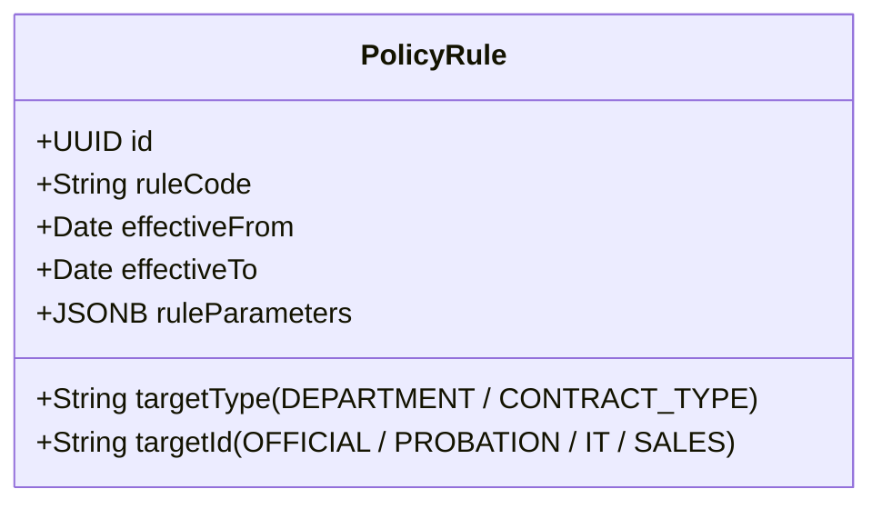

# TÀI LIỆU 03: ĐẶC TẢ PHÂN HỆ CẤU HÌNH LUẬT, CA LÀM VIỆC & HẠN NGẠCH
## Phân hệ 3 (Engine Cấu hình & Rules)

---

## 1. MỤC TIÊU THIẾT KẾ
* **Không hardcode quy định vào source code:** Tất cả chính sách (giờ giấc, mức phạt, hạn ngạch, ngày lễ) đều do HR tự cấu hình thông qua giao diện quản trị (Admin Portal).
* **Bảo toàn lịch sử (Versioning with Effective Dates):** Mọi sự thay đổi về luật chỉ áp dụng từ một mốc thời gian cụ thể trở đi, không làm sai lệch bảng công và dữ liệu tính toán của các tháng trong quá khứ.

---

## 2. QUẢN LÝ CA LÀM VIỆC (WORK SHIFTS)

### A. Các loại ca làm việc được hỗ trợ
1. **Ca Cố định (Fixed Shift):**
   * *Giờ chuẩn:* Giờ vào: `08:30` | Giờ ra: `17:30`.
   * *Nghỉ trưa:* `12:00 – 13:00` (60 phút không tính công).
   * *Thời gian làm việc chuẩn:* 8.0 giờ/công.
2. **Ca Linh hoạt (Flexible Shift):**
   * Cho phép nhân viên check-in trong khoảng: `08:00 – 09:30`.
   * Giờ check-out tự động cộng thêm đủ 8 tiếng làm việc + 1 tiếng nghỉ trưa (ví dụ check-in 09:15 thì giờ ra tối thiểu là 18:15).
3. **Ca Gãy / Ca Kíp (Split / Rotating Shift):**
   * Chia thành nhiều phân đoạn trong ngày (ví dụ: Ca 1 từ 10:00 – 14:00, Ca 2 từ 17:00 – 21:00).
   * Nhân viên phải check-in/out đủ các phân đoạn mới được tính đủ công.

### B. Gán ca làm việc (Shift Assignment)
* Gán theo **Phòng ban** (ví dụ: Toàn bộ Khối Văn phòng nhận Ca hành chính).
* Gán theo **Cá nhân** (ghi đè ca cho từng nhân sự cụ thể).
* Hỗ trợ đổi ca tạm thời theo tuần/tháng có phê duyệt của Trưởng nhóm.

---

## 3. LỊCH NGÀY LỄ & NGHỈ BÙ THEO NĂM (HOLIDAY CALENDAR)

HR có giao diện cấu hình danh mục ngày nghỉ lễ hằng năm:
* **Các thuộc tính của một ngày lễ:**
  * *Tên ngày lễ:* Tết Dương lịch, Tết Nguyên Đán, Giỗ tổ Hùng Vương, 30/4 - 1/5, Quốc khánh.
  * *Ngày bắt đầu - Ngày kết thúc.*
  * *Hưởng lương:* Mặc định = Có (100% lương cơ bản do công ty chi trả).
* **Cơ chế Ngày nghỉ bù & Đi làm bù:**
  * Nếu ngày lễ trùng vào Thứ Bảy / Chủ Nhật: HR chọn ngày làm bù tương ứng.
  * Hệ thống tự động nhận diện ngày nghỉ lễ trên bảng công (Ký hiệu `L` - Lễ) và tự động cộng 1.0 công chuẩn mà nhân viên không cần phải chấm công.

---

## 4. ENGINE QUẢN LÝ LUẬT THEO NGÀY HIỆU LỰC (RULE VERSIONING)

Mỗi chính sách áp dụng trong hệ thống đều được lưu dưới dạng một bảng cấu hình có hiệu lực thời gian:



### Ví dụ Cấu hình Tham số (Parameters):
```json
{
  "late_early_policy": {
    "max_times_per_month": 2,
    "max_minutes_per_time": 60,
    "grace_period_minutes": 10
  },
  "missed_punch_policy": {
    "max_times_per_month": 3,
    "submission_deadline_days": 3
  },
  "wfh_policy": {
    "is_allowed": true,
    "max_days_per_month": 4,
    "max_days_per_week": 1,
    "min_advance_days": 1,
    "allow_urgent": true
  },
  "annual_leave_policy": {
    "base_days_per_year": 12,
    "accrual_type": "MONTHLY",
    "tenure_bonus_step_years": 2,
    "carry_over_expiry_date": "03-31"
  }
}
```

### Ma trận Áp dụng Luật theo Đối tượng (Matrix Policy):
* **Nhân viên Chính thức:**
  * Quota đi muộn: 2 lần / tháng (tối đa 60 phút).
  * Quota WFH: 4 ngày / tháng.
  * Phép năm: 12 ngày + 1 ngày mỗi 2 năm thâm niên.
* **Nhân viên Thử việc:**
  * Quota đi muộn: 1 lần / tháng (tối đa 30 phút).
  * Quota WFH: 0 ngày / tháng (Không áp dụng).
  * Phép năm: 0 ngày (Chưa tích lũy phép cho đến khi ký hợp đồng chính thức).

---

## 5. THUẬT TOÁN TÍNH QUỸ PHÉP & THÂM NIÊN (LEAVE ACCRUAL ENGINE)

Vào 00:01 ngày đầu tiên mỗi tháng (`@Scheduled(cron = "0 1 0 1 * ?")`), Spring Boot chạy batch job:
1. Duyệt qua tất cả nhân viên có Hợp đồng chính thức còn hiệu lực (`contract_status = 'ACTIVE'`).
2. **Tính thâm niên làm việc:**
   $$\text{Thâm niên (năm)} = \frac{\text{Ngày hiện tại} - \text{Ngày bắt đầu làm việc}}{365.25}$$
   $$\text{Số ngày phép thâm niên cộng thêm} = \left\lfloor \frac{\text{Thâm niên}}{2} \right\rfloor$$
3. **Cộng phép tháng:**
   * Tăng số dư phép năm thêm: $1.0 + \frac{\text{Phép thâm niên}}{12}$ ngày.
4. **Kiểm tra hạn Phép tồn cũ (Reset hạn 31/03):**
   * Nếu ngày hiện tại là ngày `01/04`, hệ thống tự động xóa số phép tồn từ năm ngoái chưa dùng hết (`previous_year_leave_balance = 0`).
