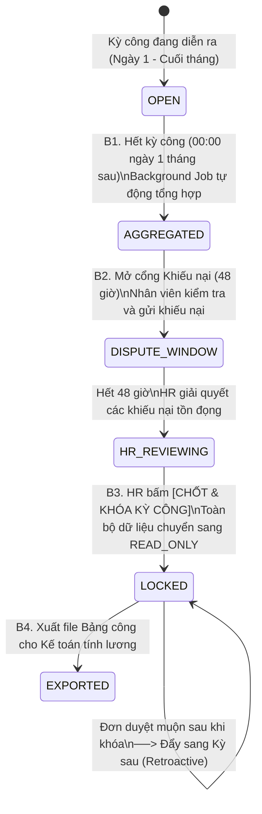

# TÀI LIỆU 04: ĐẶC TẢ PHÂN HỆ TỔNG HỢP, CHỐT CÔNG & HỒI TỐ KỲ SAU
## Phân hệ 4 (Section 6.7)

---

## 1. MỤC TIÊU VÀ Ý NGHĨA
Bảng công là **đầu vào trực tiếp của hệ thống tính lương**. Sai sót trong bảng công sẽ dẫn đến tranh chấp lao động và sai phạm kế toán.
Do đó, phân hệ này tuân thủ 2 nguyên tắc bất di bất dịch:
1. **Tính bất biến của dữ liệu đã chốt (Data Immutability):** Một khi HR đã bấm "Khóa bảng công", không một ai (kể cả Admin kỹ thuật) được phép sửa trực tiếp vào kỳ đó.
2. **Nguyên tắc Hồi tố kỳ sau (Retroactive Adjustment):** Mọi phát sinh duyệt muộn hoặc sửa sai sau ngày khóa công sẽ được chuyển thành khoản điều chỉnh cộng/trừ vào kỳ lương kế tiếp.

---

## 2. QUY TRÌNH 4 BƯỚC CHỐT CÔNG HẰNG THÁNG (CLOSING LIFECYCLE)



### Chi tiết từng giai đoạn:

#### Giai đoạn 1: Hết kỳ công & Tự động tổng hợp (Auto-Aggregation)
* Vào 00:00 ngày đầu tiên của tháng mới, Spring Boot kích hoạt tiến trình tổng hợp bảng công tháng trước:
  * Quét toàn bộ log chấm công (`attendance_punches`).
  * So khớp với danh sách đơn đã duyệt (`attendance_requests`).
  * Tính toán công thực tế, số phút đi muộn, về sớm, số ngày nghỉ phép, WFH, BHXH.
  * Sinh dữ liệu vào bảng `monthly_timesheets` với trạng thái `AGGREGATED`.

#### Giai đoạn 2: Nhân viên kiểm tra & Khiếu nại công (Dispute Window)
* **Thời hạn:** Hệ thống tự động mở cổng khiếu nại trong vòng **48 giờ** (ví dụ từ ngày 01 đến hết ngày 02 hàng tháng).
* **Trải nghiệm nhân viên:**
  * Nhân viên nhận thông báo Web Push / Email: *"Bảng công tháng [MM/YYYY] của bạn đã sẵn sàng. Vui lòng kiểm tra trong vòng 48h"*.
  * Nếu thấy thiếu giờ hoặc sai công, nhân viên bấm nút **[Khiếu nại công]**:
    * Chọn ngày sai sót.
    * Ghi rõ nội dung thắc mắc (ví dụ: *"Ngày 15 em có mặt đi làm nhưng máy quét QR báo lỗi, em có gửi ảnh qua Zalo cho Lead"*).
    * Đính kèm hình ảnh bằng chứng.

#### Giai đoạn 3: HR xử lý & Khóa bảng công (Resolution & Locking)
* HR mở màn hình **"Danh sách khiếu nại kỳ công"**:
  * Kiểm tra và phản hồi từng khiếu nại (Chấp nhận $\rightarrow$ Sửa công trực tiếp; Từ chối $\rightarrow$ Ghi rõ lý do).
* Sau khi xử lý xong tất cả khiếu nại, HR bấm nút **[CHỐT VÀ KHÓA KỲ CÔNG]**:
  * Hệ thống cập nhật `status = 'LOCKED'`.
  * Khóa cứng (Read-only) toàn bộ bảng `monthly_timesheets` và các bản ghi chi tiết của tháng đó.

#### Giai đoạn 4: Xuất dữ liệu lương (Export)
* Xuất file Excel / CSV theo định dạng chuẩn khớp với phần mềm Kế toán / ERP (Fast, Misa, SAP).

---

## 3. CƠ CHẾ ĐIỀU CHỈNH HỒI TỐ KỲ SAU (RETROACTIVE ADJUSTMENT ENGINE)

### Tình huống thực tế:
* Kỳ công Tháng 05 đã được khóa vào ngày 03/06.
* Ngày 05/06, một Trưởng phòng đi công tác về mới bấm duyệt một đơn "Bổ sung công" ngày 29/05 cho nhân viên A.

### Cách thức hệ thống xử lý:
1. **Kiểm tra trạng thái kỳ công:**
   * Backend kiểm tra ngày `2026-05-29` thuộc kỳ công Tháng 05 đã có trạng thái `LOCKED`.
2. **Không sửa ngược:**
   * Hệ thống **tuyệt đối không mở khóa** và không thay đổi bất kỳ con số nào trong bảng công Tháng 05 đã xuất cho kế toán.
3. **Sinh bản ghi Điều chỉnh hồi tố (Adjustment Record):**
   * Hệ thống tự động ghi một bản ghi vào bảng `payroll_retro_adjustments`:
     ```json
     {
       "employeeId": "EMP-00123",
       "originPeriod": "2026-05",
       "targetPeriod": "2026-06",
       "originDate": "2026-05-29",
       "adjustmentType": "ADD_WORK_DAY",
       "value": 1.0,
       "reason": "Đơn bổ sung công #REQ-9876 được duyệt muộn sau khi khóa công",
       "approvedBy": "LEAD-005",
       "approvedAt": "2026-06-05T09:15:00Z"
     }
     ```
4. **Hiển thị trên Bảng công Tháng 06:**
   * Trên bảng công Tháng 06 của nhân viên A, xuất hiện một cột chuyên biệt: **"Điều chỉnh kỳ trước" = `+1.0 công`** (kèm tooltip xem chi tiết nguồn gốc).
   * Kế toán tính lương Tháng 06 chỉ cần cộng thêm khoản công truy lĩnh này vào lương tháng mới.

---

## 4. MA TRẬN KÝ HIỆU & CÔNG THỨC TRÊN BẢNG CÔNG

### Bảng Ký hiệu Chuẩn (Standard Timesheet Symbols):
| Ký hiệu | Ý nghĩa | Quy đổi công | Nguồn chi trả |
| :---: | :--- | :---: | :--- |
| **X** | Đi làm đủ công tại văn phòng | 1.0 | Công ty trả lương |
| **X/2** | Đi làm nửa ngày (Sáng hoặc Chiều) | 0.5 | Công ty trả lương |
| **W** | Làm việc từ xa (WFH) | 1.0 | Công ty trả lương |
| **P** | Nghỉ phép năm (có lương) | 1.0 | Công ty trả lương |
| **P/2** | Nghỉ phép năm nửa ngày | 0.5 | Công ty trả lương |
| **L** | Nghỉ ngày Lễ, Tết theo quy định | 1.0 | Công ty trả lương |
| **OM** | Nghỉ ốm đau thông thường | 1.0 | Công ty trả lương (theo quy chế) |
| **TS** | Nghỉ thai sản | 0.0 (công ty) | **BHXH chi trả trợ cấp** |
| **OBS** | Nghỉ ốm dài ngày hưởng BHXH | 0.0 (công ty) | **BHXH chi trả trợ cấp** |
| **Ro** | Nghỉ việc riêng không lương | 0.0 | Không hưởng lương |
| **V** | Vắng mặt không lý do (Nghỉ không phép) | 0.0 | Phạt kỷ luật |

### Các chỉ số tổng hợp cuối tháng:
$$\text{Tổng ngày tính lương (Công ty)} = \text{X} + \text{W} + \text{P} + \text{L} + \text{OM} + \text{Điều chỉnh kỳ trước}$$
$$\text{Số ngày nghỉ hưởng BHXH} = \text{TS} + \text{OBS}$$
$$\text{Tổng số phút đi trễ} = \sum (\text{Phút check-in trễ không có đơn hợp lệ})$$
