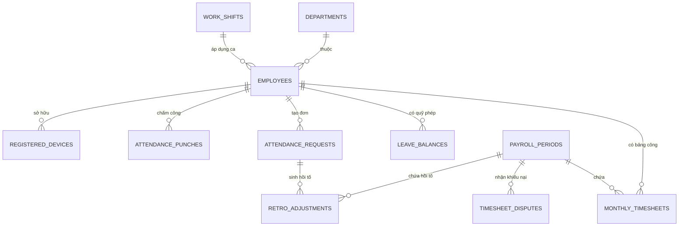

# TÀI LIỆU 05: THIẾT KẾ CƠ SỞ DỮ LIỆU CHI TIẾT (DATABASE SCHEMA)
## Hệ quản trị CSDL: MySQL 8.0+ (InnoDB, utf8mb4)

---

## 1. SƠ ĐỒ THỰC THỂ LIÊN KẾT (ENTITY RELATIONSHIP DIAGRAM)



---

## 2. BẢNG ĐẶC TẢ CHI TIẾT CÁC BẢNG (MYSQL 8.0+ DDL)

### 2.1. Nhóm Bảng Nhân sự & Tổ chức (HR & Keycloak Mapping)

```sql
-- 1. Bảng Phòng ban / Bộ phận
CREATE TABLE departments (
    id VARCHAR(36) PRIMARY KEY, -- UUID
    code VARCHAR(50) NOT NULL UNIQUE,
    name VARCHAR(150) NOT NULL,
    parent_id VARCHAR(36) NULL,
    manager_id VARCHAR(36) NULL,
    created_at DATETIME DEFAULT CURRENT_TIMESTAMP,
    updated_at DATETIME DEFAULT CURRENT_TIMESTAMP ON UPDATE CURRENT_TIMESTAMP,
    CONSTRAINT fk_dept_parent FOREIGN KEY (parent_id) REFERENCES departments(id) ON DELETE SET NULL
) ENGINE=InnoDB DEFAULT CHARSET=utf8mb4 COLLATE=utf8mb4_unicode_ci;

-- 2. Bảng Nhân viên (Map với Keycloak qua keycloak_user_id)
CREATE TABLE employees (
    id VARCHAR(36) PRIMARY KEY, -- UUID
    keycloak_user_id VARCHAR(64) UNIQUE NOT NULL, -- Subject ID (sub) từ Keycloak JWT
    employee_code VARCHAR(30) NOT NULL UNIQUE,
    full_name VARCHAR(150) NOT NULL,
    email VARCHAR(150) NOT NULL UNIQUE,
    department_id VARCHAR(36) NULL,
    direct_manager_id VARCHAR(36) NULL,
    contract_type VARCHAR(50) NOT NULL, -- 'OFFICIAL', 'PROBATION', 'INTERN'
    start_date DATE NOT NULL,
    is_active BOOLEAN DEFAULT TRUE,
    app_role VARCHAR(30) DEFAULT 'EMPLOYEE', -- 'EMPLOYEE', 'MANAGER', 'HR', 'ADMIN'
    created_at DATETIME DEFAULT CURRENT_TIMESTAMP,
    updated_at DATETIME DEFAULT CURRENT_TIMESTAMP ON UPDATE CURRENT_TIMESTAMP,
    CONSTRAINT fk_emp_dept FOREIGN KEY (department_id) REFERENCES departments(id) ON DELETE SET NULL,
    CONSTRAINT fk_emp_manager FOREIGN KEY (direct_manager_id) REFERENCES employees(id) ON DELETE SET NULL
) ENGINE=InnoDB DEFAULT CHARSET=utf8mb4 COLLATE=utf8mb4_unicode_ci;

-- 3. Bảng Thiết bị Đăng ký (Device Binding)
CREATE TABLE registered_devices (
    id VARCHAR(36) PRIMARY KEY,
    employee_id VARCHAR(36) NOT NULL,
    device_token VARCHAR(255) NOT NULL UNIQUE, -- Fingerprint Hash + Secure UUID
    device_name VARCHAR(100) NULL, -- Ví dụ: "iPhone 15 Pro", "Samsung S24"
    platform VARCHAR(50) NULL, -- "iOS", "Android", "macOS", "Windows"
    status VARCHAR(30) DEFAULT 'ACTIVE', -- 'ACTIVE', 'REVOKED', 'PENDING_APPROVAL'
    enrolled_at DATETIME DEFAULT CURRENT_TIMESTAMP,
    last_used_at DATETIME NULL,
    CONSTRAINT fk_device_emp FOREIGN KEY (employee_id) REFERENCES employees(id) ON DELETE CASCADE,
    INDEX idx_device_token (device_token)
) ENGINE=InnoDB DEFAULT CHARSET=utf8mb4 COLLATE=utf8mb4_unicode_ci;
```

---

### 2.2. Nhóm Bảng Cấu hình Luật, Ca làm việc & Ngày lễ

```sql
-- 4. Bảng Ca làm việc
CREATE TABLE work_shifts (
    id VARCHAR(36) PRIMARY KEY,
    shift_code VARCHAR(50) NOT NULL UNIQUE,
    shift_name VARCHAR(100) NOT NULL,
    shift_type VARCHAR(30) NOT NULL, -- 'FIXED', 'FLEXIBLE', 'SPLIT'
    start_time TIME NOT NULL, -- 08:30:00
    end_time TIME NOT NULL,   -- 17:30:00
    lunch_break_start TIME NULL,  -- 12:00:00
    lunch_break_end TIME NULL,    -- 13:00:00
    standard_work_hours DECIMAL(4, 2) DEFAULT 8.00,
    is_active BOOLEAN DEFAULT TRUE,
    created_at DATETIME DEFAULT CURRENT_TIMESTAMP
) ENGINE=InnoDB DEFAULT CHARSET=utf8mb4 COLLATE=utf8mb4_unicode_ci;

-- 5. Bảng Lịch Ngày lễ theo Năm (Holiday Calendar)
CREATE TABLE holiday_calendars (
    id VARCHAR(36) PRIMARY KEY,
    holiday_year INT NOT NULL,
    holiday_name VARCHAR(150) NOT NULL,
    start_date DATE NOT NULL,
    end_date DATE NOT NULL,
    is_paid BOOLEAN DEFAULT TRUE,
    compensatory_date DATE NULL, -- Ngày nghỉ bù hoặc làm bù nếu có
    created_at DATETIME DEFAULT CURRENT_TIMESTAMP,
    INDEX idx_holiday_dates (start_date, end_date)
) ENGINE=InnoDB DEFAULT CHARSET=utf8mb4 COLLATE=utf8mb4_unicode_ci;

-- 6. Bảng Cấu hình Luật có Ngày hiệu lực (Rule Versioning)
CREATE TABLE policy_rules (
    id VARCHAR(36) PRIMARY KEY,
    rule_category VARCHAR(50) NOT NULL, -- 'LATE_EARLY', 'MISSED_PUNCH', 'WFH', 'LEAVE'
    target_type VARCHAR(30) NOT NULL, -- 'ALL', 'DEPARTMENT', 'CONTRACT_TYPE'
    target_value VARCHAR(100) NOT NULL, -- 'OFFICIAL', 'IT_DEPT'
    effective_from DATE NOT NULL,
    effective_to DATE NULL, -- NULL = Vô thời hạn
    parameters JSON NOT NULL, -- Cấu hình Quota, số phút... lưu dạng JSON MySQL 8
    created_at DATETIME DEFAULT CURRENT_TIMESTAMP,
    INDEX idx_policy_effective (rule_category, target_value, effective_from, effective_to)
) ENGINE=InnoDB DEFAULT CHARSET=utf8mb4 COLLATE=utf8mb4_unicode_ci;
```

---

### 2.3. Nhóm Bảng Chấm công & Quản lý Đơn từ

```sql
-- 7. Bảng Ghi nhận Chấm công (Punches)
CREATE TABLE attendance_punches (
    id VARCHAR(36) PRIMARY KEY,
    employee_id VARCHAR(36) NOT NULL,
    punch_time DATETIME NOT NULL,
    punch_type VARCHAR(10) NOT NULL, -- 'IN', 'OUT'
    verification_method VARCHAR(30) NOT NULL, -- 'DYNAMIC_QR', 'EMERGENCY_SELFIE', 'WFH_PORTAL'
    client_ip VARCHAR(50) NOT NULL,
    device_id VARCHAR(36) NULL,
    latitude DECIMAL(10, 8) NULL,
    longitude DECIMAL(11, 8) NULL,
    is_wfh BOOLEAN DEFAULT FALSE,
    selfie_image_url TEXT NULL,
    status VARCHAR(30) DEFAULT 'VALID', -- 'VALID', 'PENDING_APPROVAL', 'REJECTED'
    created_at DATETIME DEFAULT CURRENT_TIMESTAMP,
    CONSTRAINT fk_punch_emp FOREIGN KEY (employee_id) REFERENCES employees(id) ON DELETE CASCADE,
    CONSTRAINT fk_punch_device FOREIGN KEY (device_id) REFERENCES registered_devices(id) ON DELETE SET NULL,
    INDEX idx_punches_emp_time (employee_id, punch_time)
) ENGINE=InnoDB DEFAULT CHARSET=utf8mb4 COLLATE=utf8mb4_unicode_ci;

-- 8. Bảng Quản lý Đơn từ (Requests Engine)
CREATE TABLE attendance_requests (
    id VARCHAR(36) PRIMARY KEY,
    employee_id VARCHAR(36) NOT NULL,
    request_type VARCHAR(50) NOT NULL, 
    -- 'LATE_IN', 'EARLY_OUT', 'MISSED_PUNCH', 'ANNUAL_LEAVE', 'SICK_LEAVE', 'MATERNITY', 'WFH', 'UNPAID_LEAVE'
    from_date DATE NOT NULL,
    to_date DATE NOT NULL,
    duration_minutes INT NULL, -- Cho đơn đi muộn/về sớm
    leave_units DECIMAL(3, 1) NULL, -- 1.0 ngày, 0.5 ngày
    is_recurring_wfh BOOLEAN DEFAULT FALSE,
    is_urgent BOOLEAN DEFAULT FALSE,
    reason TEXT NOT NULL,
    eod_report TEXT NULL, -- Báo cáo cuối ngày WFH
    attachment_url TEXT NULL, -- File PDF/Ảnh giấy khám y tế C65
    status VARCHAR(30) DEFAULT 'PENDING', -- 'PENDING', 'APPROVED', 'REJECTED', 'CANCELLED'
    current_approval_step INT DEFAULT 1,
    approved_by VARCHAR(36) NULL,
    rejection_reason TEXT NULL,
    applied_to_timesheet BOOLEAN DEFAULT FALSE,
    created_at DATETIME DEFAULT CURRENT_TIMESTAMP,
    updated_at DATETIME DEFAULT CURRENT_TIMESTAMP ON UPDATE CURRENT_TIMESTAMP,
    CONSTRAINT fk_req_emp FOREIGN KEY (employee_id) REFERENCES employees(id) ON DELETE CASCADE,
    CONSTRAINT fk_req_approver FOREIGN KEY (approved_by) REFERENCES employees(id) ON DELETE SET NULL,
    INDEX idx_req_emp_dates (employee_id, from_date, to_date)
) ENGINE=InnoDB DEFAULT CHARSET=utf8mb4 COLLATE=utf8mb4_unicode_ci;
```

---

### 2.4. Nhóm Bảng Quỹ phép, Kỳ công & Hồi tố (Timesheet & Payroll)

```sql
-- 9. Bảng Quỹ phép Năm của Nhân viên
CREATE TABLE employee_leave_balances (
    id VARCHAR(36) PRIMARY KEY,
    employee_id VARCHAR(36) NOT NULL,
    leave_year INT NOT NULL,
    total_accrued DECIMAL(4, 1) DEFAULT 0.0,
    tenure_bonus DECIMAL(4, 1) DEFAULT 0.0,
    carried_over DECIMAL(4, 1) DEFAULT 0.0,
    used_days DECIMAL(4, 1) DEFAULT 0.0,
    remaining_days DECIMAL(4, 1) DEFAULT 0.0,
    carry_over_expiry_date DATE NOT NULL, -- 31/03/YYYY
    updated_at DATETIME DEFAULT CURRENT_TIMESTAMP ON UPDATE CURRENT_TIMESTAMP,
    CONSTRAINT fk_bal_emp FOREIGN KEY (employee_id) REFERENCES employees(id) ON DELETE CASCADE,
    UNIQUE KEY uq_emp_leave_year (employee_id, leave_year)
) ENGINE=InnoDB DEFAULT CHARSET=utf8mb4 COLLATE=utf8mb4_unicode_ci;

-- 10. Bảng Quản lý Kỳ công (Payroll Periods)
CREATE TABLE payroll_periods (
    id VARCHAR(36) PRIMARY KEY,
    period_code VARCHAR(20) NOT NULL UNIQUE, -- '2026-05'
    start_date DATE NOT NULL,
    end_date DATE NOT NULL,
    dispute_deadline DATETIME NOT NULL, -- Hạn khiếu nại (48h)
    status VARCHAR(30) DEFAULT 'OPEN', -- 'OPEN', 'AGGREGATED', 'DISPUTE_OPEN', 'LOCKED'
    locked_by VARCHAR(36) NULL,
    locked_at DATETIME NULL,
    created_at DATETIME DEFAULT CURRENT_TIMESTAMP,
    CONSTRAINT fk_period_locker FOREIGN KEY (locked_by) REFERENCES employees(id) ON DELETE SET NULL
) ENGINE=InnoDB DEFAULT CHARSET=utf8mb4 COLLATE=utf8mb4_unicode_ci;

-- 11. Bảng Bảng công Tổng hợp Tháng (Monthly Timesheets)
CREATE TABLE monthly_timesheets (
    id VARCHAR(36) PRIMARY KEY,
    payroll_period_id VARCHAR(36) NOT NULL,
    employee_id VARCHAR(36) NOT NULL,
    standard_work_days DECIMAL(4, 2) DEFAULT 0.00,
    actual_work_days DECIMAL(4, 2) DEFAULT 0.00,
    wfh_days DECIMAL(4, 2) DEFAULT 0.00,
    paid_leave_days DECIMAL(4, 2) DEFAULT 0.00,
    unpaid_leave_days DECIMAL(4, 2) DEFAULT 0.00,
    social_insurance_days DECIMAL(4, 2) DEFAULT 0.00, -- BHXH chi trả
    holiday_paid_days DECIMAL(4, 2) DEFAULT 0.00,
    late_minutes_total INT DEFAULT 0,
    early_minutes_total INT DEFAULT 0,
    retro_adjustment_days DECIMAL(4, 2) DEFAULT 0.00, -- Hồi tố kỳ trước
    daily_details JSON NOT NULL, -- Lưu ma trận 31 ngày: {"1": "X", "2": "W", ...}
    is_locked BOOLEAN DEFAULT FALSE,
    updated_at DATETIME DEFAULT CURRENT_TIMESTAMP ON UPDATE CURRENT_TIMESTAMP,
    CONSTRAINT fk_ts_period FOREIGN KEY (payroll_period_id) REFERENCES payroll_periods(id) ON DELETE CASCADE,
    CONSTRAINT fk_ts_emp FOREIGN KEY (employee_id) REFERENCES employees(id) ON DELETE CASCADE,
    UNIQUE KEY uq_period_emp (payroll_period_id, employee_id)
) ENGINE=InnoDB DEFAULT CHARSET=utf8mb4 COLLATE=utf8mb4_unicode_ci;

-- 12. Bảng Điều chỉnh Hồi tố Kỳ sau (Retroactive Adjustments)
CREATE TABLE payroll_retro_adjustments (
    id VARCHAR(36) PRIMARY KEY,
    employee_id VARCHAR(36) NOT NULL,
    request_id VARCHAR(36) NULL,
    origin_period_id VARCHAR(36) NOT NULL,
    target_period_id VARCHAR(36) NOT NULL,
    origin_date DATE NOT NULL,
    adjustment_type VARCHAR(50) NOT NULL, -- 'ADD_WORK_DAY', 'DEDUCT_WORK_DAY', 'ADD_LEAVE'
    value DECIMAL(4, 2) NOT NULL, -- Ví dụ: 1.00 hoặc -0.50
    reason TEXT NOT NULL,
    applied_to_target_timesheet BOOLEAN DEFAULT FALSE,
    created_at DATETIME DEFAULT CURRENT_TIMESTAMP,
    CONSTRAINT fk_retro_emp FOREIGN KEY (employee_id) REFERENCES employees(id) ON DELETE CASCADE,
    CONSTRAINT fk_retro_req FOREIGN KEY (request_id) REFERENCES attendance_requests(id) ON DELETE SET NULL,
    CONSTRAINT fk_retro_origin_p FOREIGN KEY (origin_period_id) REFERENCES payroll_periods(id) ON DELETE CASCADE,
    CONSTRAINT fk_retro_target_p FOREIGN KEY (target_period_id) REFERENCES payroll_periods(id) ON DELETE CASCADE
) ENGINE=InnoDB DEFAULT CHARSET=utf8mb4 COLLATE=utf8mb4_unicode_ci;

-- 13. Bảng Khiếu nại Công trong 48h
CREATE TABLE timesheet_disputes (
    id VARCHAR(36) PRIMARY KEY,
    payroll_period_id VARCHAR(36) NOT NULL,
    employee_id VARCHAR(36) NOT NULL,
    disputed_date DATE NOT NULL,
    dispute_reason TEXT NOT NULL,
    attachment_url TEXT NULL,
    status VARCHAR(30) DEFAULT 'PENDING', -- 'PENDING', 'ACCEPTED', 'REJECTED'
    hr_response TEXT NULL,
    resolved_by VARCHAR(36) NULL,
    resolved_at DATETIME NULL,
    created_at DATETIME DEFAULT CURRENT_TIMESTAMP,
    CONSTRAINT fk_disp_period FOREIGN KEY (payroll_period_id) REFERENCES payroll_periods(id) ON DELETE CASCADE,
    CONSTRAINT fk_disp_emp FOREIGN KEY (employee_id) REFERENCES employees(id) ON DELETE CASCADE,
    CONSTRAINT fk_disp_resolver FOREIGN KEY (resolved_by) REFERENCES employees(id) ON DELETE SET NULL
) ENGINE=InnoDB DEFAULT CHARSET=utf8mb4 COLLATE=utf8mb4_unicode_ci;
```
