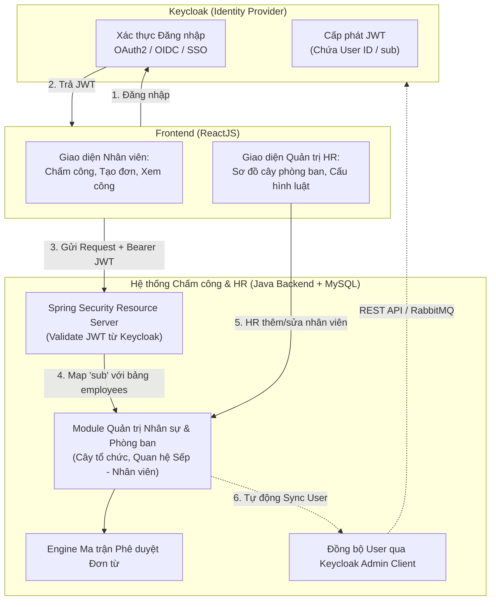

Sao tôi lại # TÀI LIỆU 06: ĐÁNH GIÁ STACK CÔNG NGHỆ & TÍCH HỢP HẠ TẦNG DOANH NGHIỆP
## Tech Stack: Java 21/25, MySQL 8+, Keycloak, ReactJS, Redis, RabbitMQ & CI/CD Pipeline

---

## 1. TỔNG QUAN ĐÁNH GIÁ STACK CÔNG NGHỆ HIỆN TẠI

Hạ tầng công nghệ hiện tại của công ty:
* **Backend:** Java Framework (Java 21/25 + Spring Boot)
* **Database:** MySQL 8.0+
* **Identity & Access Management (IAM):** Keycloak
* **Frontend:** ReactJS (PWA / Responsive Web)
* **In-Memory Caching:** Redis
* **Message Broker:** RabbitMQ
* **Hạ tầng CI/CD:** GitLab CI / Jenkins / Docker / Kubernetes (K8s)

### Kết luận sơ bộ:
Hệ thống stack này **hoàn toàn đáp ứng xuất sắc** mọi yêu cầu kỹ thuật và nghiệp vụ của hệ thống chấm công & quản lý đơn từ:
* Đảm bảo tính nhất quán (ACID), bảo mật cao, mở rộng tốt (Scalability).
* Tận dụng tối đa các service dùng chung sẵn có của doanh nghiệp (Keycloak, RabbitMQ, Redis) $\rightarrow$ Tiết kiệm 40% chi phí và thời gian triển khai, tích hợp ngay vào pipeline CI/CD hiện có mà không cần cấp phát hạ tầng mới.

---

## 2. PHÂN TÍCH CHUYÊN SÂU: KEYCLOAK VS TỰ BUILD MODULE PHÒNG BAN

### 2.1. Bản chất & Ranh giới trách nhiệm (Architectural Separation of Concerns)
* **Keycloak:** Là một hệ thống quản lý danh tính (Identity & Access Management - IAM). Keycloak giải quyết bài toán: *"Bạn là ai? (Authentication)"* và cấp phát token chứng thực chuẩn OAuth2 / OpenID Connect (OIDC).
* **Quản trị Nhân sự (HR Domain):** Giải quyết bài toán: *"Bạn thuộc phòng ban nào, ai là sếp trực tiếp duyệt đơn cho bạn, bạn còn bao nhiêu ngày phép, bạn ký loại hợp đồng gì? (HR Domain & Workflow)"*.

### 2.2. So sánh chi tiết

| Tiêu chí | Dùng Keycloak quản lý cả Phòng ban | Mô hình Khuyên dùng: Hybrid (Keycloak + Module HR tự build) |
| :--- | :--- | :--- |
| **Xác thực tài khoản (AuthN)** | Tận dụng tốt: Đăng nhập SSO, MFA, chính sách mật khẩu, quản lý session. | **Tận dụng Keycloak 100%:** Nhân viên đăng nhập qua Keycloak SSO. |
| **Quản lý Cây Phòng ban (Org Tree)** | Rất bất tiện. Phải cấu hình qua Groups/Roles của Keycloak vốn không có cấu trúc phân cấp linh hoạt cho quan hệ báo cáo quản lý (`direct_manager_id`). | **Tự build trên MySQL:** Cây tổ chức đa cấp, hỗ trợ đệ quy (`WITH RECURSIVE`), bổ nhiệm trưởng/phó phòng dễ dàng. |
| **Thuộc tính Nhân sự (Attributes)** | Phải lưu dạng Key-Value trong User Attributes của Keycloak. Không có ràng buộc toàn vẹn dữ liệu, không có khóa ngoại, khó viết báo cáo SQL. | **Lưu bảng `employees` trong MySQL:** Ràng buộc chặt chẽ ngày vào làm, thâm niên, số ngày phép, lịch sử đổi chức danh. |
| **Giao diện Người dùng (UI/UX)** | Giao diện Keycloak Admin Console dành cho kỹ sư IT, bằng tiếng Anh, phức tạp, nguy cơ rủi ro bảo mật nếu cấp quyền cho HR. | **Giao diện ReactJS thân thiện cho HR:** Sơ đồ cây trực quan (Org Chart Component), kéo thả điều chuyển nhân sự, 100% tiếng Việt. |
| **Ma trận Duyệt đơn (Workflow Matrix)** | Keycloak hoàn toàn không hỗ trợ luồng phê duyệt nghiệp vụ (Ví dụ: Lead duyệt $\rightarrow$ HR duyệt). | **Backend Java tự xử lý:** Dễ dàng kiểm tra ai là `direct_manager_id` để bắn notification và phân quyền duyệt. |

### 2.3. Kiến trúc Đề xuất: Mô hình Tích hợp Lai (Hybrid Architecture)



---

## 3. PHÂN TÍCH VAI TRÒ TỪNG THÀNH PHẦN TRONG STACK CÔNG NGHỆ

### 3.1. Java 21/25 (Spring Boot 3)
* **Virtual Threads (Project Loom):** Xử lý đồng thời hàng nghìn kết nối WebSocket từ màn hình Kiosk hiển thị mã Dynamic QR và các đợt bùng nổ request chấm công lúc 8h55 – 9h00 mà không gây nghẽn Thread pool.
* **Spring Security OAuth2 Resource Server:** Tích hợp với Keycloak chỉ trong vài dòng cấu hình:
  ```yaml
  spring:
    security:
      oauth2:
        resourceserver:
          jwt:
            issuer-uri: https://sso.congty.com/realms/company-realm
            jwk-set-uri: https://sso.congty.com/realms/company-realm/protocol/openid-connect/certs
  ```

### 3.2. MySQL 8.0+
* **Kiểu dữ liệu `JSON`:** Lưu trữ ma trận ký hiệu công 31 ngày trong tháng (`daily_details`) và cấu hình tham số luật (`parameters`) linh hoạt mà không cần thay đổi schema bảng.
* **Common Table Expressions (`WITH RECURSIVE`):** Truy vấn toàn bộ cấp dưới trong cây tổ chức của một Trưởng phòng cực nhanh:
  ```sql
  WITH RECURSIVE Subordinates AS (
      SELECT id, full_name, direct_manager_id, 1 as level 
      FROM employees WHERE id = :managerId
      UNION ALL
      SELECT e.id, e.full_name, e.direct_manager_id, s.level + 1
      FROM employees e INNER JOIN Subordinates s ON e.direct_manager_id = s.id
  )
  SELECT * FROM Subordinates;
  ```
* **InnoDB Transactions:** Đảm bảo tính toán công và chốt khóa kỳ công tuân thủ nghiêm ngặt chuẩn ACID.

### 3.3. Redis
* **Xác thực Dynamic QR trong 5-8s:** Dùng cấu trúc Key-Value với TTL. Thao tác atomic `GETDEL` loại bỏ hoàn toàn nguy cơ 2 nhân viên quét cùng 1 mã QR.
* **Cache Quota & Trạng thái:** Cache số lượt đi muộn còn lại, số ngày WFH còn lại của nhân viên giúp hiển thị tức thì trên form tạo đơn của ReactJS.

### 3.4. RabbitMQ (Xử lý Bất đồng bộ & Decoupling)
Nhờ có sẵn RabbitMQ trong hạ tầng, toàn bộ các tác vụ nặng sẽ được tách khỏi luồng chấm công chính, giúp API phản hồi dưới 50ms:

```
[Nhân viên quét QR thành công]
         │ (ghi nhận vào DB < 30ms)
         ▼
[Bắn Event vào RabbitMQ Exchange: attendance.events]
         ├── Queue 1: attendance.notification (Gửi Push/Email/Slack/Zalo)
         ├── Queue 2: attendance.kiosk.broadcast (Cập nhật TV "Chào [Tên]")
         ├── Queue 3: attendance.audit.log (Ghi log bảo mật vào ES/DB)
         └── Queue 4: attendance.image.watermark (Đóng dấu ảnh selfie khẩn cấp)
```

### 3.5. ReactJS (Frontend)
* Hỗ trợ xây dựng giao diện **Responsive Web / PWA**:
  * Trên Mobile: Dùng `@zxing/library` hoặc `html5-qrcode` bật camera quét trực tiếp.
  * Trên Desktop (HR Portal): Dùng thư viện `@xyflow/react` hoặc `react-organizational-chart` để dựng cây sơ đồ phòng ban trực quan, kéo thả chuyển phòng ban.

---

## 4. TÍCH HỢP HẠ TẦNG CI/CD HIỆN TẠI

Hệ thống hoàn toàn tương thích với pipeline CI/CD chuẩn của công ty:

```
Code Push (GitLab / GitHub)
    │
    ▼
[CI Pipeline]
    ├── Lint & Unit Tests (JUnit 5, Mockito, Vitest)
    ├── SonarQube Code Quality & Security Scan
    ├── Docker Build:
    │     ├── Backend: Eclipse Temurin Java 21/25 Multi-stage Build (Image ~180MB)
    │     └── Frontend: Node Alpine Build -> Nginx Runtime (Image ~30MB)
    │
    ▼
[Docker Registry / Harbor]
    │
    ▼
[CD Pipeline] (Argocd / GitLab Runner)
    ├── Deploy vào môi trường K8s (Staging / Production)
    ├── Helm Chart / K8s Manifests:
    │     ├── Deployment (Backend replicas: 2+)
    │     ├── Deployment (Frontend replicas: 2)
    │     ├── ConfigMaps (DB host, RabbitMQ host, Keycloak Issuer)
    │     └── Secrets (DB password, Keycloak Client Secret)
    └── Database Migration tự động qua Flyway khi pod backend khởi động
```

---

## 5. TỔNG KẾT KIẾN NGHỊ THỰC THI

1. **Về Xác thực & Tài khoản:** Giữ nguyên **Keycloak** làm IdP đăng nhập SSO toàn công ty.
2. **Về Quản lý Phòng ban & Cơ cấu:** **Xây dựng module riêng trong ứng dụng** (lưu trên MySQL) và cung cấp giao diện ReactJS cho HR. Khi HR thao tác nhân sự, Backend tự động đồng bộ sang Keycloak qua Admin API.
3. **Về Giao tiếp & Hiệu năng:** Tận dụng triệt để **Redis** (cho Dynamic QR) và **RabbitMQ** (cho thông báo, xử lý ảnh, audit log).
