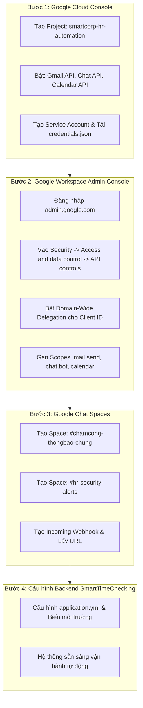

# HƯỚNG DẪN THIẾT LẬP VÀ TÍCH HỢP GOOGLE WORKSPACE
## Dành cho Doanh Nghiệp (Google Workspace) & Hướng Dẫn Dùng Thử Bằng Gmail Cá Nhân
> **Hệ thống:** SmartTimeChecking Enterprise Phase 2  
> **Kênh tích hợp:** Gmail (Actionable Email & SMTP Relay) & Google Chat (Incoming Webhooks & Card v2)

---

## PHẦN 1: GIẢI ĐÁP & HƯỚNG DẪN DÙNG THỬ BẰNG GMAIL CÁ NHÂN (TESTING MODE)

### 1.1 Tôi có thể dùng tài khoản Gmail cá nhân (@gmail.com) để thử nghiệm không?
**CÓ, HOÀN TOÀN CÓ THỂ 100%!**  
Google cho phép mọi tài khoản cá nhân miễn phí (`@gmail.com`) gửi email tự động thông qua máy chủ SMTP của Google với tính năng **Mật khẩu ứng dụng (App Password)** mà không tốn bất kỳ chi phí nào.

### 1.2 Các bước tạo "Mật khẩu ứng dụng" (App Password) trên Gmail cá nhân (Mất 2 phút)
1. **Bước 1**: Đăng nhập vào tài khoản Google cá nhân tại [myaccount.google.com](https://myaccount.google.com).
2. **Bước 2**: Vào mục **Bảo mật (Security)** $\rightarrow$ Đảm bảo đã bật **Xác minh 2 bước (2-Step Verification)** (Nếu chưa bật, hãy bật bằng số điện thoại).
3. **Bước 3**: Tại ô tìm kiếm trên đầu trang Tài khoản Google, gõ từ khóa: **`Mật khẩu ứng dụng`** (hoặc tiếng Anh: **`App passwords`**).
4. **Bước 4**: Bấm vào mục **Mật khẩu ứng dụng**:
   * Nhập tên ứng dụng: `SmartTimeChecking`.
   * Bấm nút **Tạo (Create)**.
5. **Bước 5**: Google sẽ cấp một mật khẩu ngẫu nhiên gồm **16 ký tự** (dạng `abcd efgh ijkl mnop`).
6. **Bước 6**: Sao chép 16 ký tự này và cấu hình vào hệ thống SmartTimeChecking:
   * **Host:** `smtp.gmail.com`
   * **Port:** `587`
   * **Username:** Địa chỉ Gmail của bạn (ví dụ: `yourname@gmail.com`)
   * **Password:** Dán 16 ký tự mật khẩu ứng dụng vừa tạo.

> [!TIP]
> Ngay sau khi cấu hình 16 ký tự này, hệ thống SmartTimeChecking sẽ gửi email thật 100% đến bất kỳ hòm thư nào (cả Gmail, Outlook, Yahoo...) với các nút bấm phê duyệt 1 chạm (One-Click Approval)!

### 1.3 Thử nghiệm Google Chat bằng tài khoản cá nhân
1. Truy cập [chat.google.com](https://chat.google.com).
2. Tạo một **Không gian (Space)** mới, ví dụ đặt tên: `SmartCorp - Thông Báo`.
3. Bấm vào tên Không gian $\rightarrow$ Chọn **Cài đặt ứng dụng và tiện ích tích hợp (Apps & integrations)**.
4. Chọn **Webhook** $\rightarrow$ Bấm **Thêm webhook (Add webhook)** $\rightarrow$ Đặt tên: `SmartTime Bot` $\rightarrow$ Sao chép URL Webhook.
5. Dán URL Webhook này vào cấu hình SmartTimeChecking để bắn thông báo và card tương tác trực tiếp vào Space của bạn!

> [!NOTE]
> Nếu tài khoản cá nhân của bạn chưa được Google mở tính năng Webhook trong Space cá nhân, hệ thống SmartTimeChecking đã tích hợp sẵn **Bộ Giả Lập Google Chat Card v2 Trực Quan (Interactive Simulator)** ngay trên trang Quản lý / HR để bạn có thể xem trước mẫu Card và bấm nút Duyệt / Từ chối trải nghiệm ngay lập tức.

---

## PHẦN 2: HƯỚNG DẪN THIẾT LẬP CHUẨN DOANH NGHIỆP (GOOGLE WORKSPACE PRODUCTION)

Dành cho Quản trị viên IT (Google Workspace Super Admin) khi triển khai chính thức cho toàn bộ công ty.



### Bước 1: Thiết lập trên Google Cloud Console
1. Truy cập [console.cloud.google.com](https://console.cloud.google.com) bằng tài khoản quản trị viên công ty.
2. Tạo một Project mới:
   * **Project Name:** `smartcorp-hr-automation`
   * **Organization:** Chọn tên tổ chức công ty của bạn.
3. Vào mục **APIs & Services $\rightarrow$ Library**:
   * Tìm kiếm và bấm **Enable** cho 3 dịch vụ:
     1. **Gmail API**
     2. **Google Chat API**
     3. **Google Calendar API**
4. Vào mục **APIs & Services $\rightarrow$ Credentials**:
   * Bấm **Create Credentials** $\rightarrow$ Chọn **Service Account**.
   * Đặt tên: `smarttime-notification-sa`.
   * Cấp quyền: `Project Editor` (hoặc quyền gửi email).
   * Tại tab **Keys** của Service Account vừa tạo $\rightarrow$ Bấm **Add Key** $\rightarrow$ **Create new key (JSON)**.
   * File chứng chỉ `credentials.json` sẽ tự động được tải về máy.
   * Sao chép mã **Client ID (OAuth 2.0 Client ID)** dạng số của Service Account (sẽ dùng ở Bước 2).

---

### Bước 2: Bật Quyền Domain-Wide Delegation trên Google Workspace Admin
1. Đăng nhập vào trang quản trị Google Workspace: [admin.google.com](https://admin.google.com).
2. Trên thanh điều hướng bên trái, vào:
   **Bảo mật (Security)** $\rightarrow$ **Quyền truy cập và kiểm soát dữ liệu (Access and data control)** $\rightarrow$ **Kiểm soát API (API controls)**.
3. Cuộn xuống phần **Ủy quyền trên toàn miền (Domain-wide delegation)** $\rightarrow$ Bấm **Quản lý ủy quyền trên toàn miền (Manage Domain Wide Delegation)**.
4. Bấm **Thêm mới (Add new)**:
   * **Client ID:** Dán mã Client ID của Service Account đã lấy ở Bước 1.
   * **OAuth Scopes:** Nhập danh sách các quyền sau (cách nhau bằng dấu phẩy):
     ```
     https://www.googleapis.com/auth/gmail.send,
     https://www.googleapis.com/auth/chat.bot,
     https://www.googleapis.com/auth/calendar.events
     ```
5. Bấm **Ủy quyền (Authorize)**.
   * Kể từ lúc này, Backend SmartTimeChecking có thể gửi email nhân danh hòm thư đại diện công ty như `hr@smartcorp.com` mà không cần lộ mật khẩu hòm thư.

---

### Bước 3: Thiết lập Các Không Gian (Spaces) trên Google Chat
1. Mở [chat.google.com](https://chat.google.com) bằng tài khoản công ty.
2. Tạo 2 Không gian làm việc chuẩn:
   * **Không gian 1: `#chamcong-thongbao-chung`**
     * Quyền thành viên: Toàn thể nhân viên công ty.
     * Mục đích: Bản tin điểm danh lúc 09:00 sáng hàng ngày (Ai có mặt, ai WFH, ai nghỉ phép), thông báo lịch nghỉ Tết, nghỉ lễ.
     * Cài đặt Webhook: Bấm tên Space $\rightarrow$ **Ứng dụng và tiện ích tích hợp** $\rightarrow$ **Thêm webhook** $\rightarrow$ Đặt tên `Điểm Danh Bot` $\rightarrow$ Lưu URL Webhook.
   * **Không gian 2: `#hr-security-alerts`**
     * Quyền thành viên: Ban Giám Đốc (`BOD`) và chuyên viên Phòng Nhân sự (`HR`).
     * Mục đích: Nhận thẻ cảnh báo tức thời khi có chấm công khẩn cấp gian lận lệch GPS $> 100\text{m}$ (`FLAG_LOCATION_MISMATCH`) hoặc chấm bằng thiết bị lạ.
     * Cài đặt Webhook: Tương tự như trên, lưu URL Webhook.

---

### Bước 4: Cấu hình Thông Số vào Hệ Thống SmartTimeChecking
Doanh nghiệp có thể cấu hình bằng 1 trong 2 cách cực kỳ linh hoạt:

#### Cách A: Cấu hình trực tiếp trên Giao diện Quản trị (Khuyên dùng khi demo / dùng thử)
1. Đăng nhập vào giao diện web SmartTimeChecking với tài khoản HR (`hr@congty.com` hoặc `ceo@smartcorp.com`).
2. Vào tab **"Quản lý / HR"** $\rightarrow$ Chọn tab con **"Google Workspace (Gmail & Chat)"**.
3. Điền các trường thông số:
   * **Gmail SMTP Host:** `smtp.gmail.com`
   * **Gmail SMTP Port:** `587`
   * **Email Người gửi:** `your-email@gmail.com`
   * **Mật khẩu ứng dụng (App Password):** 16 ký tự mật khẩu ứng dụng vừa tạo.
   * **Google Chat Webhook Chung:** URL Webhook của Space `#chamcong-thongbao-chung`.
   * **Google Chat Webhook Cảnh Báo:** URL Webhook của Space `#hr-security-alerts`.
4. Bấm nút **"Lưu Cấu Hình"** $\rightarrow$ Bấm nút **"Bắn Thẻ Test"** hoặc **"Gửi Email Test"** để kiểm tra tức thì!

#### Cách B: Cấu hình qua Biến Môi Trường (Khi triển khai Docker / Production)
Cấu hình trong file `application.yml` hoặc Docker Compose environment variables:
```yaml
smarttime:
  notification:
    gmail:
      enabled: true
      host: ${GMAIL_SMTP_HOST:smtp.gmail.com}
      port: ${GMAIL_SMTP_PORT:587}
      username: ${GMAIL_USERNAME:hr@smartcorp.com}
      password: ${GMAIL_APP_PASSWORD:your-16-char-app-password}
      sender-name: "SmartCorp HR Portal"
    google-chat:
      enabled: true
      general-webhook-url: ${GCHAT_GENERAL_WEBHOOK:https://chat.googleapis.com/v1/spaces/...}
      alerts-webhook-url: ${GCHAT_ALERTS_WEBHOOK:https://chat.googleapis.com/v1/spaces/...}
    one-click-approval:
      base-url: ${APP_BASE_URL:http://localhost:8085}
      secret-key: ${APPROVAL_SECRET:SmartCorpSecureOneClickSecretKey2026}
      token-expiry-hours: 24
```

---

## 3. CHECKLIST KIỂM THỬ TÍCH HỢP HOÀN TẤT (UAT VERIFICATION)

| Bước kiểm thử | Thao tác thực hiện | Kết quả mong đợi |
| :---: | :--- | :--- |
| **Test 1** | Bấm nút "Gửi Email Test" trên giao diện HR | Hòm thư đích nhận được email HTML responsive màu sắc đẹp mắt |
| **Test 2** | Bấm nút "Bắn Thẻ Chat Test" trên giao diện HR | Space Google Chat xuất hiện Card tương tác v2 kèm 2 nút [Phê Duyệt] và [Từ Chối] |
| **Test 3** | Nhân viên nộp đơn WFH hoặc Đi muộn | Sếp nhận được email Actionable kèm nút duyệt 1 chạm + Google Chat gửi card thông báo |
| **Test 4** | Sếp mở email và click nút **[✅ Phê Duyệt]** | Đơn chuyển sang trạng thái APPROVED ngay lập tức, không cần đăng nhập web |
| **Test 5** | Nhân viên chấm công khẩn cấp giả lập lệch GPS $> 100\text{m}$ | Space `#hr-security-alerts` nhận được thẻ cảnh báo đỏ vi phạm vị trí GPS tức thời |
| **Test 6** | Bấm nút "Kích hoạt Bản tin Sáng 09:00" | Space `#chamcong-thongbao-chung` nhận bản tin điểm danh tổng kết quân số văn phòng hôm nay |

