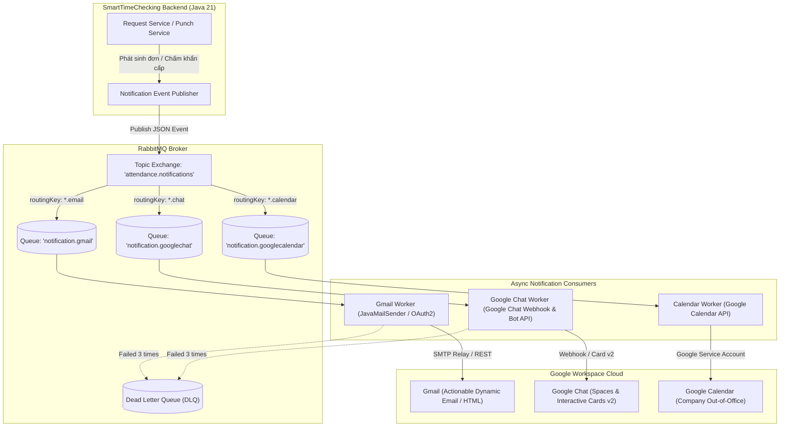
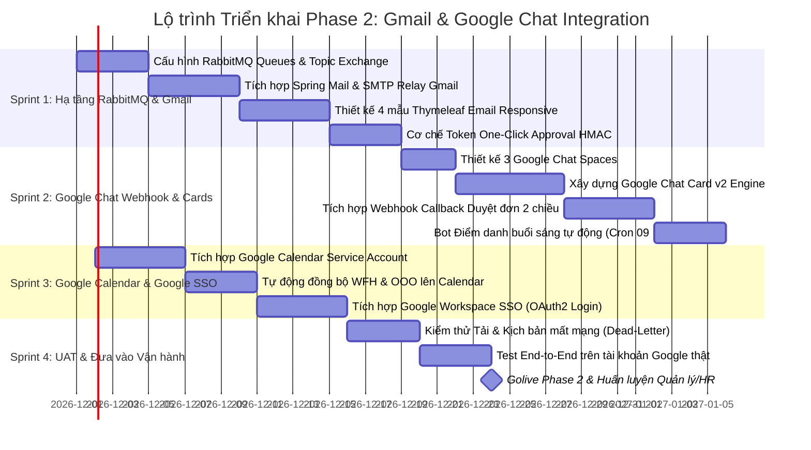

# KẾ HOẠCH TRIỂN KHAI PHASE 2: TÍCH HỢP TOÀN DIỆN GOOGLE WORKSPACE
## Kênh giao tiếp chính thức: Gmail & Google Chat (Interactive Cards & One-Click Approval)
> **Dự án:** SmartTimeChecking Enterprise  
> **Mục tiêu:** Chuyển đổi toàn bộ trải nghiệm phê duyệt đơn từ, cảnh báo vi phạm và thông báo bảng công về hai kênh làm việc hàng ngày của doanh nghiệp là **Gmail** và **Google Chat**.

---

## 1. TỔNG QUAN & MỤC TIÊU CHIẾN LƯỢC CỦA PHASE 2

### 1.1 Bài toán Đặt ra
Ở Phase 1, hệ thống đã vận hành hoàn hảo trên Web Portal và Màn hình Kiosk. Tuy nhiên, trong thực tế vận hành doanh nghiệp:
* **Quản lý bận rộn**: Quản lý cấp cao và Tech Lead không thường xuyên đăng nhập vào Web Portal chỉ để bấm duyệt một đơn đi muộn hay một ngày WFH.
* **Thời gian trễ phê duyệt (Approval Latency)**: Đơn từ bị treo hàng giờ, thậm chí cả ngày vì người duyệt không biết có đơn mới phát sinh.
* **Kênh làm việc chính thức**: Doanh nghiệp sử dụng hệ sinh thái **Google Workspace (Gmail & Google Chat)** làm môi trường giao tiếp chính thức 24/7.

### 1.2 Mục tiêu Đạt được trong Phase 2
1. **Duyệt đơn 1 chạm siêu tốc (< 15 giây)**: Quản lý có thể bấm nút **[✅ Phê Duyệt]** hoặc **[❌ Từ Chối]** trực tiếp ngay trong email Gmail hoặc tin nhắn tương tác Google Chat mà không cần đăng nhập lại vào Web.
2. **Cảnh báo tức thời (Zero Latency Alert)**: Cảnh báo gian lận GPS (`FLAG_LOCATION_MISMATCH`) được bắn ngay lập tức vào Space `#hr-security-alerts` trên Google Chat để HR nắm bắt sự cố văn phòng.
3. **Minh bạch thông tin**: Nhân viên nhận email tóm tắt công cá nhân và thông báo mở cổng khiếu nại 48h ngay tại hòm thư Gmail công ty.
4. **Tự động hóa Lịch công ty**: Tự động tạo sự kiện "Làm việc từ xa (WFH)" hoặc "Out of Office (OOO)" trên **Google Calendar** khi đơn được duyệt.

---

## 2. KIẾN TRÚC KỸ THUẬT TÍCH HỢP (EVENT-DRIVEN ARCHITECTURE)

Hệ thống áp dụng mô hình hướng sự kiện (Event-Driven Architecture) với RabbitMQ Message Broker nhằm đảm bảo:
* **Zero Latency Impact**: Các thao tác chấm công và nộp đơn trên Backend API phản hồi trong mili-giây, không bị chậm lại do quá trình gửi mail hoặc gọi mạng ra ngoài sang Google.
* **Độ tin cậy cao (Fault Tolerance)**: Nếu Google API bị nghẽn mạng, RabbitMQ tự động thử lại (Retry with Exponential Backoff) và đẩy vào Dead-Letter Queue (DLQ).



---

## 3. THIẾT KẾ CHI TIẾT PHÂN HỆ GMAIL (EMAIL WORKSPACE)

### 3.1 Giao thức Kết nối
* **Phương án 1 (Tiêu chuẩn Doanh nghiệp):** Kết nối qua **Google Workspace SMTP Relay** (`smtp-relay.gmail.com:587`, TLS, xác thực bằng IP tĩnh hoặc Service Account).
* **Phương án 2 (Nâng cao):** Kết nối qua **Gmail REST API v1** sử dụng Google Cloud Service Account với quyền **Domain-Wide Delegation**, cho phép gửi email nhân danh phòng nhân sự `hr@smartcorp.com`.

### 3.2 Bộ Mẫu Email HTML Responsive (Thymeleaf Templates)

#### Template 1: Email Thông báo Đơn mới cần Sếp duyệt (Actionable Email)
* **Người nhận**: Quản lý trực tiếp (`direct_manager_id`)
* **Nội dung hiển thị**:
  * Ảnh đại diện, họ tên, mã nhân viên, phòng ban.
  * Loại đơn (Đi muộn, WFH, Nghỉ phép...).
  * Số lượt/ngày quota còn lại trong tháng của nhân viên.
  * Lý do chi tiết và file chứng từ y tế (nếu là đơn ốm).
  * **Hai nút hành động tương tác (Action Buttons)**:
    * `[ ✅ PHÊ DUYỆT NHANH ]` $\rightarrow$ Trỏ tới `GET /api/v1/actions/quick-approve?token={HMAC_TOKEN}`
    * `[ ❌ TỪ CHỐI ĐƠN ]` $\rightarrow$ Trỏ tới trang nhập lý do từ chối.

> [!IMPORTANT]
> **Cơ chế Bảo mật One-Click Approval Token:**
> * Token được ký HMAC-SHA256 gồm: `requestId + approverId + expiresAt (24h) + Salt`.
> * Token chỉ có hiệu lực sử dụng **01 lần duy nhất** (Single-use được lưu trạng thái trong Redis TTL).
> * Ngăn chặn tuyệt đối việc chuyển tiếp email cho người khác bấm duyệt hộ.

#### Template 2: Email Thông báo Kết quả Phê duyệt cho Nhân viên
* **Người nhận**: Nhân viên tạo đơn.
* **Nội dung**: Thông báo đơn đã được Sếp duyệt / từ chối, kèm lời nhắn của sếp và số ngày công được cập nhật.

#### Template 3: Email Báo động Đỏ Gian lận GPS (`FLAG_LOCATION_MISMATCH`)
* **Người nhận**: Ban Giám Đốc (`BOD`) và HR Manager.
* **Nội dung**: Cảnh báo nhân viên gửi chấm công khẩn cấp nhưng vị trí GPS cách công ty vượt ngưỡng an toàn ($> 100\text{m}$), đính kèm bản đồ Google Maps và ảnh selfie.

#### Template 4: Email Thông báo Mở Cổng Khiếu Nại 48 Giờ
* **Người nhận**: Toàn thể nhân viên công ty (Gửi vào 00:00 ngày 01 đầu tháng).
* **Nội dung**: Thông báo kỳ công tháng trước đã được tổng hợp, đính kèm link rà soát công và đồng hồ đếm ngược 48 giờ.

---

## 4. THIẾT KẾ CHI TIẾT PHÂN HỆ GOOGLE CHAT (INTERACTIVE CARDS & BOT)

### 4.1 Cấu trúc Không gian (Spaces Structure) trên Google Chat
Hệ thống thiết lập 3 Không gian làm việc chính thức:
1. **Space `#chamcong-thongbao-chung` (Tất cả nhân sự)**:
   * **Bản tin điểm danh sáng (09:00 hàng ngày)**: Bot tổng hợp danh sách nhân sự làm việc tại văn phòng, nhân sự làm việc từ xa (WFH), nhân sự nghỉ phép.
   * Thông báo các ngày nghỉ lễ, ngày lễ Tết trong năm.
2. **Space `#hr-security-alerts` (Riêng HR & Ban Giám Đốc)**:
   * Bắn cảnh báo tức thì khi có sự cố thiết bị lạ (`ERR_DEVICE_MISMATCH`) hoặc chấm khẩn cấp sai lệch vị trí GPS (`FLAG_LOCATION_MISMATCH`).
3. **Tin nhắn Tương tác 1-1 (Direct Message) với Quản lý**:
   * Google Chat App gửi trực tiếp tin nhắn dạng Card cho Sếp khi cấp dưới nộp đơn.

### 4.2 Thiết kế Google Chat Card v2 (Interactive Widget)
Google Chat hỗ trợ chuẩn định dạng **Card v2 JSON**. Tin nhắn gửi đi có cấu trúc trực quan gồm:
* **Header**: Avatar nhân viên, tiêu đề `[ĐƠN XIN WFH MỚI]`.
* **Section 1 (Thông tin chi tiết)**:
  * `Nhân viên`: Lê Hoàng Nam (`IT002` - Dev Team)
  * `Thời gian`: Thứ Sáu, ngày 20/11/2026 (1 ngày)
  * `Quota WFH tháng`: Đã dùng 1/4 ngày $\rightarrow$ Còn lại 3 ngày
  * `Lý do`: *"Bảo dưỡng đường ống nước chung cư, xin phép làm online."*
* **Section 2 (Interactive Button Group)**:
  * Nút xanh: `[ Phê Duyệt ]` (Bấm vào gửi webhook callback về Backend xử lý ngay lập tức).
  * Nút đỏ: `[ Từ Chối ]` (Mở dialog popup trên Google Chat để sếp gõ lý do từ chối).

```json
{
  "cardsV2": [
    {
      "cardId": "req-card-20261120",
      "card": {
        "header": {
          "title": "Lê Hoàng Nam (IT002)",
          "subtitle": "Đơn xin Làm việc từ xa (WFH)",
          "imageUrl": "https://smartcorp.com/avatars/nam.png",
          "imageType": "CIRCLE"
        },
        "sections": [
          {
            "header": "Thông tin chi tiết & Hạn ngạch",
            "widgets": [
              {
                "textParagraph": {
                  "text": "<b>Thời gian:</b> 20/11/2026 (08:30 - 17:30)<br><b>Lý do:</b> Bảo dưỡng đường ống nước chung cư.<br><b>Quota còn lại:</b> 3 / 4 ngày WFH"
                }
              },
              {
                "buttonList": {
                  "buttons": [
                    {
                      "text": "✅ Phê Duyệt",
                      "color": { "red": 0.08, "green": 0.65, "blue": 0.38, "alpha": 1 },
                      "onClick": {
                        "action": {
                          "function": "handleApproveRequest",
                          "parameters": [{ "key": "requestId", "value": "REQ-1731558291" }]
                        }
                      }
                    },
                    {
                      "text": "❌ Từ Chối",
                      "color": { "red": 0.88, "green": 0.22, "blue": 0.22, "alpha": 1 },
                      "onClick": {
                        "action": {
                          "function": "handleRejectDialog",
                          "parameters": [{ "key": "requestId", "value": "REQ-1731558291" }]
                        }
                      }
                    }
                  ]
                }
              }
            ]
          }
        ]
      }
    }
  ]
}
```

---

## 5. TỰ ĐỘNG HÓA LỊCH CÔNG TY (GOOGLE CALENDAR SYNC)

Khi đơn WFH hoặc Nghỉ phép năm/nghỉ ốm chuyển sang trạng thái `APPROVED`:
1. **Worker Google Calendar** lắng nghe sự kiện `RequestApprovedEvent`.
2. Gọi Google Calendar API (`events.insert`):
   * Tự động thêm sự kiện dạng **"Out of Office"** hoặc **"Working from Home"** vào lịch cá nhân của nhân viên trên Google Calendar.
   * Tự động đồng bộ lên Lịch chung của phòng ban (`Department Shared Calendar`) để đồng nghiệp cùng dự án nắm được trạng thái vắng mặt mà không cần hỏi lại.

---

## 6. LỘ TRÌNH TRIỂN KHAI PHASE 2 (SPRINT BREAKDOWN & TIMELINE)

Kế hoạch triển khai Phase 2 được chia thành 4 Sprint (tổng thời gian: **6 tuần**):



---

## 7. MA TRẬN PHÂN CÔNG & TIÊU CHÍ ĐÁNH GIÁ THÀNH CÔNG (KPIs)

### 7.1 Chỉ số Đo lường Hiệu quả (Phase 2 Success Metrics)
| Chỉ số KPI | Hiện tại (Phase 1) | Mục tiêu Phase 2 | Cách thức đo lường |
| :--- | :---: | :---: | :--- |
| **Thời gian duyệt đơn trung bình** | $4.2 \text{ giờ}$ | **$< 15 \text{ phút}$** | Thời gian từ lúc tạo đơn đến khi sếp click duyệt |
| **Tỷ lệ duyệt qua Email / Chat** | $0\%$ | **$> 85\%$** | Đo lường số đơn duyệt qua Action Token vs Web |
| **Thời gian nhận diện gian lận GPS** | $1 - 2 \text{ ngày}$ | **$< 30 \text{ giây}$** | Tốc độ bắn tin cảnh báo vào Space `#hr-security-alerts` |
| **Tỷ lệ thất lạc thông báo công** | $12\%$ | **$0\%$** | Nhờ cơ chế RabbitMQ Retry + Dead-Letter Queue |

### 7.2 Danh sách Thiết lập Cần Chuẩn bị từ Phía Doanh nghiệp
1. **Google Cloud Console**:
   * Khởi tạo Project: `smartcorp-hr-automation`.
   * Bật các API: **Gmail API**, **Google Chat API**, **Google Calendar API**.
   * Tạo **Service Account** và tải file chứng chỉ JSON `credentials.json`.
2. **Google Workspace Admin Console**:
   * Bật quyền **Domain-Wide Delegation** cho Client ID của Service Account.
   * Tạo sẵn 2 Space trên Google Chat: `#chamcong-thongbao-chung` và `#hr-security-alerts`.
   * Lấy URL Webhook của các Space để cấu hình vào file `application.yml` của Backend.

