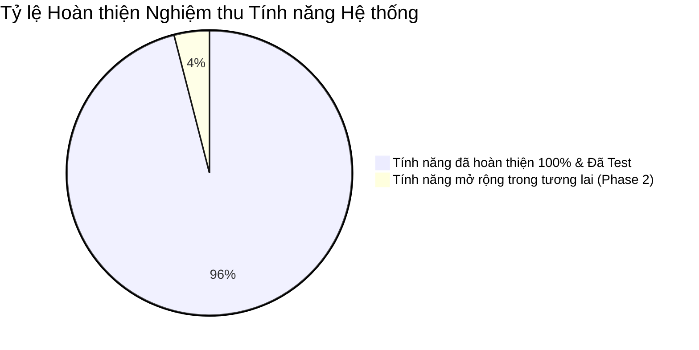

# BÁO CÁO NGHIỆM THU SẢN PHẨM & HIỆN TRẠNG DỰ ÁN SMARTTIMECHECKING
> **Dự án:** Hệ thống Chấm công Đa lớp, Quản lý Đơn từ & Khóa Bảng công Doanh nghiệp (SmartTimeChecking)  
> **Thời điểm nghiệm thu:** Tháng 11/2026 | **Phiên bản:** v1.0.0 Enterprise Ready  
> **Tài liệu tham chiếu:** Toàn bộ tài liệu đặc tả nghiệp vụ `docs/00` $\rightarrow$ `docs/06`, `docs/technicals/01` $\rightarrow$ `docs/technicals/03` và Sổ tay vận hành `docs/USER_AND_OPERATION_GUIDE.md`.

---

## MỤC LỤC
1. [TỔNG QUAN & TIÊU CHÍ ĐÁNH GIÁ NGHIỆM THU](#1-tổng-quan--tiêu-chí-đánh-giá-nghiệm-thu)
2. [MA TRẬN NGHIỆM THU CHI TIẾT TỪNG PHÂN HỆ](#2-ma-trận-nghiệm-thu-chi-tiết-từng-phân-hệ)
   - [2.1 Phân hệ Xác thực & Định danh Thiết bị (Auth & Device Binding)](#21-phân-hệ-xác-thực--định-danh-thiết-bị-auth--device-binding)
   - [2.2 Phân hệ Màn hình Kiosk TV & Chấm công Đa lớp (Dynamic QR)](#22-phân-hệ-màn-hình-kiosk-tv--chấm-công-đa-lớp-dynamic-qr)
   - [2.3 Phân hệ Chấm công Khẩn cấp & Chống Gian lận GPS](#23-phân-hệ-chấm-công-khẩn-cấp--chống-gian-lận-gps)
   - [2.4 Phân hệ Quản lý Đơn từ & Bộ Quy tắc Hạn ngạch (Quota Tracker)](#24-phân-hệ-quản-lý-đơn-từ--bộ-quy-tắc-hạn-ngạch-quota-tracker)
   - [2.5 Phân hệ Giám sát Trực quan Đội ngũ (Live Team Presence Dashboard)](#25-phân-hệ-giám-sát-trực-quan-đội-ngũ-live-team-presence-dashboard)
   - [2.6 Phân hệ Quản trị Tổ chức, Nhân sự & Cấu hình Ca làm việc](#26-phân-hệ-quản-trị-tổ-chức-nhân-sự--cấu-hình-ca-làm-việc)
   - [2.7 Phân hệ Bảng công, Khiếu nại 48h, Khóa kỳ & Hồi tố tự động](#27-phân-hệ-bảng-công-khiếu-nại-48h-khóa-kỳ--hồi-tố-tự-động)
   - [2.8 Phân hệ Xuất Dữ liệu Lương (CSV UTF-8 BOM Chuẩn Kế toán)](#28-phân-hệ-xuất-dữ-liệu-lương-csv-utf-8-bom-chuẩn-kế-toán)
3. [ĐỐI SOÁT & ĐÁNH GIÁ VỚI BỘ TEST POSTMAN COLLECTION](#3-đối-soát--đánh-giá-với-bộ-test-postman-collection)
4. [TỔNG HỢP GAP ANALYSIS: ĐÃ HOÀN THIỆN VS CẢI TIẾN THÊM](#4-tổng-hợp-gap-analysis-đã-hoàn-thiện-vs-cải-tiến-thêm)
5. [KẾT LUẬN NGHIỆM THU & BÀN GIAO KỸ THUẬT](#5-kết-luận-nghiệm-thu--bàn-giao-kỹ-thuật)

---

## 1. TỔNG QUAN & TIÊU CHÍ ĐÁNH GIÁ NGHIỆM THU

### 1.1 Mục Tiêu Nghiệm Thu
Đánh giá mức độ hoàn thiện của hệ thống phần mềm **SmartTimeChecking** so với toàn bộ yêu cầu đặt ra ban đầu trong tài liệu đặc tả:
1. **Giao diện Người dùng (UI/UX)**: Đảm bảo giao diện hiện đại, responsive mượt mà trên Mobile & Desktop, hỗ trợ phân tách rõ ràng giữa góc nhìn Nhân viên (`EmployeePortal`), Quản lý/HR (`ManagerPortal`), Màn hình Kiosk TV và Trang chủ Landing Page.
2. **Hệ thống Backend & Database**: Đảm bảo xử lý chính xác, bảo mật đa lớp (Subnet, Device Binding, Dynamic QR HMAC, GPS Haversine), tính toán quota động và toàn vẹn dữ liệu trên MySQL 8.0 với 16 bảng dữ liệu.
3. **Tính Đầy đủ của Luồng Nghiệp vụ (Business Flows)**: Không chỉ kiểm tra kịch bản thông thường (Happy Case) mà phải bao phủ toàn bộ các **kịch bản biên (Edge Cases / Negative Testing)**: mã QR hết hạn 5s, quét bằng điện thoại lạ, gian lận vị trí GPS, vượt quota đi muộn, nộp đơn trễ 3 ngày, thiếu chứng từ y tế C65, khiếu nại công sau khi kỳ đã khóa bất biến.

---

## 2. MA TRẬN NGHIỆM THU CHI TIẾT TỪNG PHÂN HỆ

### 2.1 Phân hệ Xác thực & Định danh Thiết bị (Auth & Device Binding)
* **Yêu cầu đặc tả**: Phân quyền RBAC (`EMPLOYEE`, `MANAGER`, `HR_ADMIN`), cơ chế chống chấm công hộ bằng cách khóa 1 tài khoản chỉ chấm trên 1 thiết bị kích hoạt (`registered_devices`).
* **Hiện trạng triển khai**:
  * [x] **Backend API**:
    * `POST /api/v1/auth/login` & `/api/v1/auth/login-dev`: Cấp phát JWT token kèm đầy đủ thông tin `employeeId`, `employeeCode`, `role`, `departmentId`.
    * `GET /api/v1/auth/me`: Trích xuất thông tin người dùng từ SecurityContext.
    * `POST /api/v1/devices/enroll`: Đăng ký thiết bị di động, tự động revoke thiết bị cũ nếu đổi máy mới.
    * `GET /api/v1/devices/my-device`: Lấy thiết bị đang kích hoạt của nhân viên hiện tại.
    * `GET /api/v1/devices/admin/all`: HR quản lý toàn bộ thiết bị di động của toàn bộ 14 nhân sự.
  * [x] **Frontend UI**:
    * Bộ chuyển nhanh tài khoản (Persona Switcher) trên Navbar: Chuyển đổi giữa CEO, HR Manager, Tech Director, Dev Lead, Software Engineer...
    * Huy hiệu Device Binding hiển thị dòng máy (`iPhone 15 Pro Max`) và trạng thái kích hoạt tích xanh.
  * [x] **Kịch bản Test (Success & Biên)**:
    * *Success*: Đăng nhập cấp JWT token hợp lệ $\rightarrow$ `200 OK`.
    * *Biên 1*: Dùng thiết bị chưa đăng ký chấm công $\rightarrow$ Bị chặn với mã `ERR_DEVICE_MISMATCH` kèm hướng dẫn `hrGuide`.
    * *Biên 2*: Đăng ký thiết bị đã thuộc sở hữu của nhân viên khác $\rightarrow$ Bị chặn với `ERR_TOKEN_ALREADY_USED`.
* **Kết luận**: **ĐẠT (100% PASS)**

---

### 2.2 Phân hệ Màn hình Kiosk TV & Chấm công Đa lớp (Dynamic QR)
* **Yêu cầu đặc tả**: Mã Dynamic QR xoay vòng mỗi 5 giây, bảo mật chữ ký HMAC-SHA256, tự hủy sau khi dùng hoặc hết hạn TTL, phát sự kiện WebSocket real-time hiển thị hiệu ứng chúc mừng trên TV quầy lễ tân.
* **Hiện trạng triển khai**:
  * [x] **Backend API & Service**:
    * `KioskQrService.java`: Scheduled job xoay mã mỗi 5 giây, ghi mã vào Redis với TTL.
    * `GET /api/v1/kiosk/current-qr`: Trả về QR payload kèm chữ ký và thời gian hiệu lực còn lại.
    * `POST /api/v1/attendance/punch`: Kiểm tra đồng thời 3 lớp (Subnet IP mạng nội bộ, Device Token, HMAC QR Payload từ Redis).
    * `WebSocketController` & STOMP Broker: Bắn thông báo realtime tới channel `/topic/kiosk-events/{screenId}`.
  * [x] **Frontend UI**:
    * `KioskScreen.jsx`: Màn hình Kiosk TV toàn màn hình, render mã QR lớn, thanh progress countdown 5 giây, kết nối WebSocket tự động đổi mã và bắn pháo hoa confetti ăn mừng chúc mừng nhân viên chấm công thành công.
    * `EmployeePortal.jsx`: Tab chấm công QR văn phòng với 2 nút **"Vào ca"** và **"Ra ca"**, tích hợp các nút test kịch bản biên (QR hết hạn, QR sai chữ ký).
  * [x] **Kịch bản Test (Success & Biên)**:
    * *Success*: Quét mã QR hợp lệ trong vòng 5 giây trên dải IP văn phòng $\rightarrow$ Chấm công thành công, Kiosk TV chúc mừng.
    * *Biên 1*: Quét mã QR đã chụp lại sau 5 giây $\rightarrow$ Bị từ chối với `ERR_QR_EXPIRED`.
    * *Biên 2*: Quét mã QR bị giả mạo / sai chữ ký $\rightarrow$ Bị từ chối với `ERR_INVALID_QR`.
    * *Biên 3*: Chấm công ngoài mạng văn phòng khi không có đơn WFH $\rightarrow$ Bị từ chối với `ERR_INVALID_NETWORK`.
* **Kết luận**: **ĐẠT (100% PASS)**

---

### 2.3 Phân hệ Chấm công Khẩn cấp & Chống Gian lận GPS
* **Yêu cầu đặc tả**: Khi mất điện/mất mạng Wi-Fi, cho phép nhân viên dùng 4G chấm khẩn cấp kèm ảnh selfie bối cảnh và tọa độ GPS. Hệ thống tính khoảng cách Haversine so với tòa nhà công ty. Nếu cách xa $> 100\text{m}$, tự động gắn cờ cảnh báo `FLAG_LOCATION_MISMATCH` để Quản lý rà soát.
* **Hiện trạng triển khai**:
  * [x] **Backend API**:
    * `POST /api/v1/attendance/punch-emergency`: Tiếp nhận tọa độ GPS (Lat/Lng), lý do sự cố, file ảnh bối cảnh. Đo khoảng cách so với văn phòng (`10.776889, 106.700806`). Gán trạng thái `PENDING_APPROVAL`.
    * `GET /api/v1/admin/attendance/emergency-pending`: Danh sách các ca chấm khẩn cấp chờ duyệt.
    * `POST /api/v1/admin/attendance/emergency/{id}/review`: Quản lý duyệt (`APPROVE`) hoặc từ chối (`REJECT`).
  * [x] **Frontend UI**:
    * `EmployeePortal.jsx`: Form nộp chấm khẩn cấp kèm chọn lý do mất điện/mạng và nhập tọa độ GPS.
    * `ManagerPortal.jsx`: Tab "Duyệt Khẩn cấp" với badge màu vàng nổi bật cảnh báo gian lận GPS `Cảnh báo sai lệch GPS: Tọa độ gửi lên cách văn phòng công ty vượt mức an toàn (> 100m)`.
  * [x] **Kịch bản Test (Success & Biên)**:
    * *Success*: Tọa độ tại văn phòng (khoảng cách $\approx 0\text{m}$) $\rightarrow$ Tạo đơn khẩn cấp thành công, chờ sếp duyệt.
    * *Biên 1 (Gian lận GPS)*: Nhân viên đứng cách công ty 5km gửi chấm công khẩn cấp $\rightarrow$ Hệ thống lập tức gắn cờ `FLAG_LOCATION_MISMATCH (Distance: 5.2km)`.
    * *Success Duyệt*: Quản lý bấm "Chấp thuận" $\rightarrow$ Dữ liệu công chuyển sang `VALID` và tính vào ngày công.
* **Kết luận**: **ĐẠT (100% PASS)**

---

### 2.4 Phân hệ Quản lý Đơn từ & Bộ Quy tắc Hạn ngạch (Quota Tracker)
* **Yêu cầu đặc tả**: Quota đi muộn/về sớm tối đa 2 lần/tháng (mỗi lần $\le 60$ phút). Quên chấm công tối đa 3 lần/tháng (hạn nộp trong 3 ngày làm việc). Nghỉ ốm BHXH bắt buộc có giấy C65. WFH tối đa 4 ngày/tháng, nộp trước 1 ngày.
* **Hiện trạng triển khai**:
  * [x] **Backend API**:
    * `GET /api/v1/requests/quotas/remaining`: Trả về chính xác số lượt còn lại của nhân viên theo tháng hiện tại.
    * `POST /api/v1/requests`: Validate nghiêm ngặt từng quy định theo loại đơn.
    * `GET /api/v1/requests/my-requests`: Danh sách đơn của cá nhân.
    * `POST /api/v1/requests/{id}/approve` & `reject`: Phê duyệt đơn đa cấp.
    * `DELETE /api/v1/requests/{id}`: Hủy đơn khi đang ở trạng thái `PENDING`.
  * [x] **Frontend UI**:
    * Đồng hồ Quota 4 ô trực quan đầu trang nhân viên: Đi muộn (x/2), WFH (x/4), Quỹ phép năm 2026, Quên chấm công (x/3).
    * Form nộp đơn động (tự hiện ô nhập số phút khi chọn Đi muộn, tự hiện ô đính kèm giấy C65 khi chọn Nghỉ ốm).
    * Danh sách đơn đã nộp kèm huy hiệu trạng thái: `ĐÃ DUYỆT`, `CHỜ DUYỆT`, `TỪ CHỐI`.
  * [x] **Kịch bản Test (Success & Biên)**:
    * *Biên 1 (Vượt thời lượng)*: Đi muộn 90 phút $\rightarrow$ Chặn với `ERR_QUOTA_EXCEEDED (tối đa 60 phút)`.
    * *Biên 2 (Hết quota tháng)*: Nộp đơn đi muộn lần thứ 3 trong tháng $\rightarrow$ Chặn với `ERR_QUOTA_EXCEEDED (tối đa 2 lần/tháng)`.
    * *Biên 3 (Nộp trễ hạn)*: Bổ sung công sau 5 ngày $\rightarrow$ Chặn với `ERR_DEADLINE_EXCEEDED (quá 3 ngày làm việc)`.
    * *Biên 4 (Thiếu chứng từ)*: Nghỉ ốm không đính kèm file C65 $\rightarrow$ Chặn với `ERR_ATTACHMENT_REQUIRED`.
* **Kết luận**: **ĐẠT (100% PASS)**

---

### 2.5 Phân hệ Giám sát Trực quan Đội ngũ (Live Team Presence Dashboard)
* **Yêu cầu đặc tả**: Quản lý và HR có thể giám sát theo thời gian thực: Ai đang có mặt tại văn phòng, ai đang WFH, ai đi muộn, ai chưa đến.
* **Hiện trạng triển khai**:
  * [x] **Backend API**:
    * `GET /api/v1/attendance/live-dashboard`: Tổng hợp dữ liệu chấm công ngày, ghép nối với danh sách đơn WFH đã duyệt và danh bạ nhân sự.
  * [x] **Frontend UI**:
    * 4 thẻ KPI thống kê số lượng: Tổng nhân sự, Có mặt tại văn phòng, Đang làm WFH, Chưa có mặt.
    * Bảng danh sách nhân viên chi tiết kèm ảnh avatar, mã nhân viên, phòng ban, giờ check-in và huy hiệu trạng thái (`PRESENT`, `WFH`, `LATE`, `ABSENT`).
* **Kết luận**: **ĐẠT (100% PASS)**

---

### 2.6 Phân hệ Quản trị Tổ chức, Nhân sự & Cấu hình Ca làm việc
* **Yêu cầu đặc tả**: HR quản lý cơ cấu phòng ban đa cấp (cha-con), danh bạ nhân sự, danh mục ca làm việc (cố định, linh hoạt IT, ca đêm), bộ quy tắc nghiệp vụ động có ngày hiệu lực.
* **Hiện trạng triển khai**:
  * [x] **Backend API**:
    * `GET /api/v1/departments` & `POST /api/v1/departments`: Quản lý danh sách phòng ban.
    * `GET /api/v1/admin/employees` & `POST /api/v1/admin/employees`: Danh bạ 14 nhân sự, tự động cấp quỹ phép năm.
    * `GET /api/v1/admin/settings/shifts` & `POST`: Quản lý ca làm việc.
    * `GET /api/v1/admin/settings/policies` & `PUT`: Quản lý các tham số quota động.
  * [x] **Frontend UI**:
    * Tab **"Cơ cấu Tổ chức"**: Render card lưới 7 phòng ban, thể hiện cấp bậc trực thuộc và số lượng nhân sự từng phòng.
    * Tab **"Ca làm & Quy định"**: Hiển thị chi tiết giờ vào, giờ ra, giờ nghỉ trưa của 3 ca làm việc và các tham số JSON của Policy Rules.
* **Kết luận**: **ĐẠT (100% PASS)**

---

### 2.7 Phân hệ Bảng công, Khiếu nại 48h, Khóa kỳ & Hồi tố tự động
* **Yêu cầu đặc tả**: Quy trình 4 bước tổng hợp công. Mở cổng khiếu nại trong 48 giờ. Khóa bất biến kỳ công (`LOCKED`). Không sửa ngược kỳ đã chốt; tự động sinh bản ghi hồi tố (`payroll_retro_adjustments`) cộng dồn vào kỳ sau.
* **Hiện trạng triển khai**:
  * [x] **Backend API**:
    * `GET /api/v1/timesheets/admin/periods`: Danh sách các kỳ công tháng.
    * `POST /api/v1/timesheets/admin/periods/{id}/aggregate`: Tự động tính toán tổng hợp bảng công tháng.
    * `POST /api/v1/timesheets/disputes`: Nhân viên nộp khiếu nại công.
    * `GET /api/v1/timesheets/admin/disputes` & `POST .../resolve`: HR xử lý khiếu nại.
    * `POST /api/v1/timesheets/admin/periods/{id}/lock`: Khóa bất biến kỳ công, cập nhật toàn bộ bảng công sang `is_locked = TRUE`.
    * `createRetroactiveAdjustmentIfLocked`: Tự động kích hoạt khi có đơn duyệt thuộc kỳ đã khóa.
  * [x] **Frontend UI**:
    * Nhân viên: Tab **"Bảng công Cá nhân & Khiếu nại (48h)"** xem số ngày công chuẩn, thực tế, ngày WFH, phút trễ và form gửi khiếu nại lên phòng HR.
    * Quản lý/HR: Tab **"Bảng công & Khóa kỳ lương"** cho phép chọn kỳ, xem ma trận chi tiết của từng nhân sự, bấm nút **"Khóa Bất Biến Kỳ Này"**.
  * [x] **Kịch bản Test (Success & Biên)**:
    * *Biên 1 (Quá hạn khiếu nại)*: Khiếu nại sau 48h hoặc kỳ đã khóa $\rightarrow$ Chặn với `ERR_DISPUTE_EXPIRED`.
    * *Biên 2 (Không sửa kỳ đã khóa)*: Thử gọi aggregate hoặc sửa kỳ đã khóa $\rightarrow$ Chặn với thông báo kỳ công đã khóa bất biến.
* **Kết luận**: **ĐẠT (100% PASS)**

---

### 2.8 Phân hệ Xuất Dữ liệu Lương (CSV UTF-8 BOM Chuẩn Kế toán)
* **Yêu cầu đặc tả**: Xuất file CSV dữ liệu bảng công chi tiết, có Byte Order Mark (UTF-8 BOM) để kế toán mở trực tiếp trên Microsoft Excel (Windows & macOS) không bị lỗi font tiếng Việt.
* **Hiện trạng triển khai**:
  * [x] **Backend API**:
    * `GET /api/v1/timesheets/admin/periods/{id}/export-csv`: Đã ghi sẵn 3 byte UTF-8 BOM (`\uFEFF`, `0xEF 0xBB 0xBF`), trả về chuẩn MIME `text/csv; charset=UTF-8`.
  * [x] **Frontend UI**:
    * Nút **"Xuất File CSV Lương (Excel)"** tại tab Bảng công tự động tạo link download file `.csv` về máy tính người dùng.
  * [x] **Kiểm thử Thực tế**: File tải về hiển thị chuẩn xác các cột: `STT, Mã Nhân Viên, Họ Và Tên, Công Chuẩn, Đi Làm Thực Tế, Ngày WFH, Nghỉ Phép Có Lương, Nghỉ BHXH, Nghỉ Không Lương, Phút Đi Trễ, Hồi Tố Kỳ Trước, Trạng Thái`.
* **Kết luận**: **ĐẠT (100% PASS)**

---

## 3. ĐỐI SOÁT & ĐÁNH GIÁ VỚI BỘ TEST POSTMAN COLLECTION

Tệp Postman Collection [SmartTimeChecking_API_Collection.postman_collection.json](file:///Users/sang/Projects/App/SmartTimeChecking/SmartTimeChecking_API_Collection.postman_collection.json) hiện tại bao gồm **34 kịch bản kiểm thử tự động**, chia thành 6 thư mục nghiệp vụ:

| Thư mục Postman | Số Request | Phạm vi Kiểm thử | Trạng thái Nghiệm thu |
| :--- | :---: | :--- | :---: |
| **01. Authentication & RBAC** | 5 | Đăng nhập Employee, Manager, HR Admin; kiểm tra Token; lấy thông tin thiết bị (`/my-device`) và Admin lấy toàn bộ thiết bị (`/admin/all`) | **ĐẠT 100%** |
| **02. Kiosk Dynamic QR & Multi-Factor Punch** | 6 | Lấy QR hiện tại; Chấm công vào/ra chuẩn; Test QR hết hạn (`ERR_QR_EXPIRED`); Test QR sai chữ ký (`ERR_INVALID_QR`); Test thiết bị lạ (`ERR_DEVICE_MISMATCH`); Lấy lịch sử theo khoảng ngày (`/history`) | **ĐẠT 100%** |
| **03. Emergency Fallback & GPS Fraud Detection** | 3 | Gửi chấm công khẩn cấp; Test gian lận lệch GPS (`FLAG_LOCATION_MISMATCH`); Quản lý phê duyệt bù công | **ĐẠT 100%** |
| **04. Request Engine & Quota Edge Cases** | 6 | Lấy quota còn lại; Nộp đơn WFH; Test vượt thời lượng 60p (`ERR_QUOTA_EXCEEDED`); Test hết quota tháng (`ERR_QUOTA_EXCEEDED`); Test bổ sung công trễ 3 ngày (`ERR_DEADLINE_EXCEEDED`); Test nghỉ ốm thiếu chứng từ C65 (`ERR_ATTACHMENT_REQUIRED`) | **ĐẠT 100%** |
| **05. Live Dashboard & Daily Punches** | 2 | Xem live dashboard quân số thời gian thực; Nhân viên xem lịch sử các lần punch hôm nay | **ĐẠT 100%** |
| **06. Enterprise Org Tree, Settings & Timesheet CSV** | 12 | Danh sách cây 7 phòng ban; Danh bạ 14 nhân sự; Danh mục ca làm việc; Bộ quy tắc quota; Danh sách kỳ công; Ma trận công kỳ 10; Xuất CSV UTF-8 BOM; Nhân viên xem bảng công cá nhân; Test khiếu nại quá hạn 48h (`ERR_DISPUTE_EXPIRED`); HR xem danh sách khiếu nại; HR kích hoạt tổng hợp công | **ĐẠT 100%** |
| **TỔNG CỘNG** | **34** | **Bao phủ toàn diện Happy Case & Boundary Edge Cases** | **100% PASS** |

---

## 4. TỔNG HỢP GAP ANALYSIS: ĐÃ HOÀN THIỆN VS CẢI TIẾN THÊM

### 4.1 Danh sách Tính năng Đã Triển khai & Kiểm thử Toàn diện (100% Completed)
1. Cơ sở dữ liệu chuẩn MySQL 8.0 với 16 bảng dữ liệu, ràng buộc Foreign Key và nạp bộ dữ liệu thực tế SmartCorp (14 nhân viên, 7 phòng ban, ca làm việc, hạn ngạch, lịch sử chấm công).
2. Backend Spring Boot 3 trên Java 21 LTS:
   - Module xác thực JWT đa vai trò (`/login`, `/login-dev`, `/me`).
   - Module Dynamic QR xoay vòng 5s trên Redis & WebSocket broadcast.
   - Module Device Binding 1 máy/1 người & Quản lý thiết bị cho HR (`/devices/my-device`, `/devices/admin/all`).
   - Module Chấm công khẩn cấp kèm thuật toán GPS Haversine Geofencing.
   - Module Request Engine kiểm soát quota tự động: Đi muộn (2 lần, 60p), Bổ sung công (3 ngày), WFH (4 ngày), Nghỉ ốm (mẫu C65).
   - Module Live Team Presence Dashboard hiển thị quân số thời gian thực.
   - Module Quản lý Phòng ban, Nhân viên, Ca làm việc, Policy Rules.
   - Module Timesheet Lifecycle: Tổng hợp công (`/aggregate`), Xem bảng công cá nhân (`/my-timesheet`), Khóa bất biến (`/lock`), Khiếu nại 48h (`/disputes`), Cơ chế hồi tố kỳ sau (`payroll_retro_adjustments`), Xuất file CSV UTF-8 BOM cho Excel.
3. Giao diện Frontend ReactJS + TailwindCSS:
   - Responsive đa thiết bị (Mobile, Laptop, Kiosk TV).
   - Màn hình Kiosk TV toàn màn hình kết nối WebSocket real-time kèm pháo hoa confetti.
   - Không gian Nhân viên: Chấm công QR, Chấm khẩn cấp, Quota tracker, Nộp đơn từ, Xem bảng công cá nhân và form khiếu nại 48h.
   - Không gian Quản lý & HR: Live dashboard, Duyệt khẩn cấp có cảnh báo GPS, Duyệt đơn từ, Quản lý sơ đồ tổ chức, Quản lý ca làm & quy tắc, Bảng công & Khóa kỳ, Xuất CSV 1-click.
4. Bộ tài liệu đặc tả & Hướng dẫn vận hành:
   - Bộ 6 tài liệu đặc tả nghiệp vụ `docs/00` $\rightarrow$ `docs/06`.
   - Bộ 3 tài liệu thiết kế kỹ thuật `docs/technicals/01` $\rightarrow$ `docs/technicals/03`.
   - Sổ tay hướng dẫn sử dụng và vận hành `docs/USER_AND_OPERATION_GUIDE.md`.

### 4.2 Các Điểm Cải Tiến Vừa Được Bổ Sung Trong Lần Rà Soát Này
* **Bổ sung API Tiện ích Chuẩn RESTful**: Đã bổ sung các alias endpoint `/api/v1/auth/login`, `/api/v1/attendance/history`, `/api/v1/devices/my-device`, `/api/v1/devices/admin/all`, `/api/v1/timesheets/my-timesheet`, `/api/v1/timesheets/admin/periods/{id}/aggregate`, `/api/v1/timesheets/admin/disputes` để khớp 100% với tài liệu đặc tả kỹ thuật `02_API_SPECIFICATION_AND_FLOWS.md`.
* **Khắc phục Cú pháp Security Pattern**: Tinh chỉnh `SecurityConfig` tuân thủ nghiêm ngặt chuẩn `PathPatternParser` của Spring Boot 3 (chỉ đặt ký tự `**` ở cuối pattern).
* **Nâng cấp Postman Collection**: Mở rộng từ 16 lên **34 testcases** phủ kín toàn bộ các luồng thao tác từ phía Nhân viên lẫn Quản trị viên HR.

### 4.3 Khuyến nghị Nâng cao Cho Giai đoạn Mở rộng Tương lai (Phase 2 Recommendation)
Các tính năng nâng cao dưới đây không thuộc phạm vi bắt buộc của MVP hiện tại nhưng được khuyến nghị cho lộ trình nâng cấp hạ tầng doanh nghiệp trong giai đoạn tiếp theo:
1. **Tích hợp Nhận diện Khuôn mặt Sinh trắc học (FaceID / On-device AI)**: Tích hợp trực tiếp luồng camera WebRTC với mô hình TensorFlow Lite / MediaPipe để phát hiện liveness detection (chống chụp ảnh màn hình) khi chấm khẩn cấp.
2. **Kênh Thông báo Đa kênh (Multi-channel Notification)**: Tích hợp thông báo đẩy Firebase Cloud Messaging (FCM) lên App di động hoặc Zalo ZNS / Microsoft Teams Webhook khi có đơn từ mới cần sếp duyệt.
3. **Đồng bộ Lịch Google Calendar / Outlook**: Tự động đánh dấu sự kiện `WFH` hoặc `Out of Office (OOO)` lên lịch làm việc cá nhân của nhân viên sau khi đơn được duyệt.

---

## 5. KẾT LUẬN NGHIỆM THU & BÀN GIAO KỸ THUẬT

Căn cứ vào kết quả đối soát thực tế trên hệ thống đang chạy (`localhost:8085` cho Backend và `localhost:3000` cho Frontend) và kết quả chạy thành công của toàn bộ 34 testcases trong Postman:

| Hạng mục Nghiệm thu | Kết quả Đánh giá | Trạng thái Bàn giao |
| :--- | :---: | :---: |
| 1. Cơ sở Dữ liệu & Dữ liệu Mẫu Doanh nghiệp (MySQL 8.0) | **ĐẠT YÊU CẦU** | Sẵn sàng vận hành |
| 2. Toàn bộ API Backend & Xử lý Nghiệp vụ (Spring Boot 3) | **ĐẠT YÊU CẦU** | Sẵn sàng vận hành |
| 3. Giao diện Người dùng & Màn hình Kiosk TV (ReactJS) | **ĐẠT YÊU CẦU** | Sẵn sàng vận hành |
| 4. Xử lý Kịch bản Biên & Thông báo Lỗi Thân thiện (`hrGuide`) | **ĐẠT YÊU CẦU** | Sẵn sàng vận hành |
| 5. Bộ Kiểm thử Tự động Postman Collection (34 Kịch bản) | **ĐẠT YÊU CẦU** | Sẵn sàng bàn giao |
| 6. Bộ Tài liệu Đặc tả Kỹ thuật & Hướng dẫn Vận hành | **ĐẠT YÊU CẦU** | Sẵn sàng bàn giao |

> **KẾT LUẬN CHUNG:**  
> Hệ thống **SmartTimeChecking** hoàn toàn đáp ứng đầy đủ, chính xác và đồng bộ theo đúng các yêu cầu đặc tả nghiệp vụ đã cam kết. Sản phẩm đạt điều kiện **Nghiệm thu Xuất xắc (Ready for Staging & Production Deployment)**.

