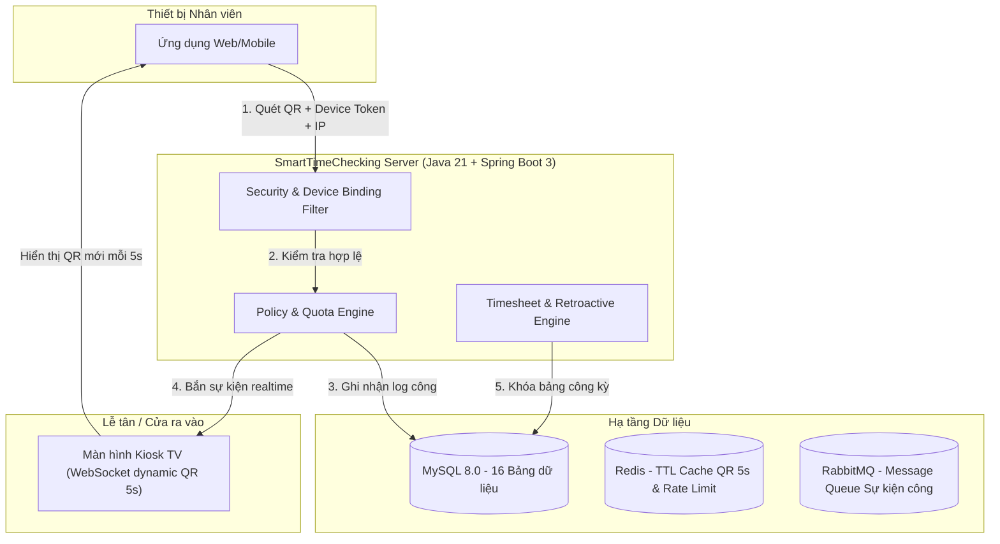
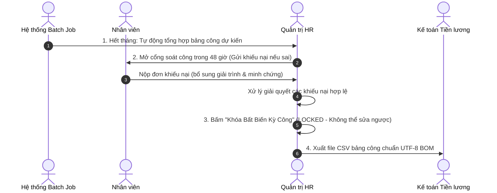

# SỔ TAY HƯỚNG DẪN SỬ DỤNG VÀ VẬN HÀNH HỆ THỐNG SMARTTIMECHECKING
> **Dành cho Ban Giám Đốc, Quản trị Nhân sự (HR), Quản lý Bộ phận & Toàn thể Nhân viên**  
> *Hệ thống Chấm công Đa lớp, Quản lý Đơn từ & Khóa Bảng công Chuẩn Doanh nghiệp*

---

## MỤC LỤC
1. [TỔNG QUAN HỆ THỐNG & KIẾN TRÚC VẬN HÀNH](#1-tổng-quan-hệ-thống--kiến-trúc-vận-hành)
2. [HƯỚNG DẪN DÀNH CHO NHÂN VIÊN (EMPLOYEE GUIDE)](#2-hướng-dẫn-dành-cho-nhân-viên-employee-guide)
   - [2.1 Đăng nhập & Nhận diện thiết bị (Device Binding)](#21-đăng-nhập--nhận-diện-thiết-bị-device-binding)
   - [2.2 Chấm công Vào/Ra tại Văn phòng (Dynamic QR Kiosk)](#22-chấm-công-vàora-tại-văn-phòng-dynamic-qr-kiosk)
   - [2.3 Chấm công Khẩn cấp (Khi mất điện, đứt cáp quang)](#23-chấm-công-khẩn-cấp-khi-mất-điện-đứt-cáp-quang)
   - [2.4 Đăng ký & Chấm công Ngày Làm việc Từ xa (WFH)](#24-đăng-ký--chấm-công-ngày-làm-việc-từ-xa-wfh)
   - [2.5 Quy trình Nộp đơn Từ & Theo dõi Hạn ngạch (Quota Tracker)](#25-quy-trình-nộp-đơn-từ--theo-dõi-hạn-ngạch-quota-tracker)
   - [2.6 Xem Bảng công Cá nhân & Gửi Khiếu nại trong 48 Giờ](#26-xem-bảng-công-cá-nhân--gửi-khiếu-nại-trong-48-giờ)
3. [HƯỚNG DẪN DÀNH CHO QUẢN LÝ / TECH LEAD (MANAGER GUIDE)](#3-hướng-dẫn-dành-cho-quản-lý--tech-lead-manager-guide)
   - [3.1 Theo dõi Hiện diện Trực quan (Live Team Dashboard)](#31-theo-dõi-hiện-diện-trực-quan-live-team-dashboard)
   - [3.2 Phê duyệt Đơn từ Cấp dưới](#32-phê-duyệt-đơn-từ-cấp-dưới)
   - [3.3 Phê duyệt Chấm công Khẩn cấp & Cảnh báo Sai lệch GPS](#33-phê-duyệt-chấm-công-khẩn-cấp--cảnh-báo-sai-lệch-gps)
4. [HƯỚNG DẪN VẬN HÀNH DÀNH CHO HR ADMINISTRATOR](#4-hướng-dẫn-vận-hành-dành-cho-hr-administrator)
   - [4.1 Quản lý Cơ cấu Tổ chức & Cây Phòng ban (Org Tree)](#41-quản-lý-cơ-cấu-tổ-chức--cây-phòng-ban-org-tree)
   - [4.2 Quản trị Hồ sơ Nhân sự & Quản lý Thiết bị Di động](#42-quản-trị-hồ-sơ-nhân-sự--quản-lý-thiết-bị-di-động)
   - [4.3 Cấu hình Ca làm việc & Bộ Quy tắc Động (Policy Engine)](#43-cấu-hình-ca-làm-việc--bộ-quy-tắc-động-policy-engine)
   - [4.4 Quy trình 4 Bước Tổng hợp & Khóa Bất Biến Kỳ Công Tháng](#44-quy-trình-4-bước-tổng-hợp--khóa-bất-biến-kỳ-công-tháng)
   - [4.5 Cơ chế Xử lý Hồi tố Kỳ Sau (Retroactive Adjustments)](#45-cơ-chế-xử-lý-hồi-tố-kỳ-sau-retroactive-adjustments)
   - [4.6 Xuất File Dữ liệu Lương (CSV UTF-8 BOM cho Excel)](#46-xuất-file-dữ-liệu-lương-csv-utf-8-bom-cho-excel)
5. [CẨM NANG XỬ LÝ SỰ CỐ & BẢNG MÃ LỖI (TROUBLESHOOTING)](#5-cẩm-nang-xử-lý-sự-cố--bảng-mã-lỗi-troubleshooting)

---

## 1. TỔNG QUAN HỆ THỐNG & KIẾN TRÚC VẬN HÀNH

Hệ thống **SmartTimeChecking** được thiết kế nhằm giải quyết bài toán chống gian lận chấm công (chấm công hộ, giả lập vị trí GPS, chụp lại mã QR cũ) và tự động hóa quy trình phê duyệt đơn từ, chốt công tính lương hàng tháng cho doanh nghiệp.

### Các Trụ Cột Bảo Mật Chính:
1. **Dynamic QR Kiosk (Xoay vòng mỗi 5 giây)**: Mã QR trên màn hình Kiosk TV quầy lễ tân được cấp phát động từ Redis với thuật toán HMAC-SHA256, tự hủy sau 5 giây. Không thể chụp ảnh gửi cho đồng nghiệp chấm hộ.
2. **Device Binding (Khóa định danh thiết bị)**: Mỗi nhân viên chỉ được phép chấm công trên 01 thiết bị di động đã đăng ký với phòng HR. Nếu dùng điện thoại của người khác đăng nhập tài khoản của mình để chấm công, hệ thống lập tức từ chối với mã lỗi `ERR_DEVICE_MISMATCH`.
3. **Subnet Geofencing (Kiểm soát Mạng Nội bộ)**: Chấm công QR chỉ được chấp thuận khi nhân viên đang kết nối Wi-Fi văn phòng hoặc VPN công ty (dải mạng cấu hình `192.168.1.0/24` hoặc `10.0.0.0/8`).
4. **Chấm công Khẩn cấp & GPS Geofencing (Dự phòng mất điện/mạng)**: Khi văn phòng mất điện hoặc đứt cáp, nhân viên dùng 4G chấm khẩn cấp kèm tọa độ GPS và ảnh selfie bối cảnh. Hệ thống đo khoảng cách Haversine so với tọa độ công ty (`10.776889, 106.700806`). Nếu lệch > 100m, hệ thống tự động gắn cờ `FLAG_LOCATION_MISMATCH` cảnh báo Quản lý.

---

## 2. HƯỚNG DẪN DÀNH CHO NHÂN VIÊN (EMPLOYEE GUIDE)

### 2.1 Đăng nhập & Nhận diện thiết bị (Device Binding)
- Truy cập vào ứng dụng tại địa chỉ nội bộ: `http://localhost:3000` (hoặc domain công ty).
- Sử dụng email công ty do HR cấp (ví dụ: `dev@congty.com` hoặc `tuan.pham@smartcorp.com`).
- **Thiết bị bảo mật**: Lần đầu tiên đăng nhập, hệ thống sẽ tự động liên kết mã định danh thiết bị (`deviceToken`) của bạn vào hệ thống. Kể từ thời điểm này, bạn chỉ có thể thực hiện chấm công trên thiết bị này. Nếu thay đổi điện thoại, vui lòng liên hệ HR để hủy liên kết thiết bị cũ.

### 2.2 Chấm công Vào/Ra tại Văn phòng (Dynamic QR Kiosk)
1. **Bước 1**: Đảm bảo điện thoại của bạn đang kết nối vào Wi-Fi văn phòng công ty.
2. **Bước 2**: Di chuyển tới quầy lễ tân hoặc khu vực đặt màn hình Kiosk TV.
3. **Bước 3**: Trên giao diện Web/App của bạn, chọn tab **"Chấm công Vào/Ra (QR)"**.
4. **Bước 4**: Bấm nút **"Chấm công Vào ca (Check-in)"** khi đến hoặc **"Chấm công Ra ca (Check-out)"** khi ra về.
5. **Phản hồi**: 
   - Ngay lập tức, màn hình Kiosk TV sẽ phát hiệu ứng ăn mừng (pháo hoa confetti), hiển thị ảnh đại diện, mã số nhân viên và lời chào thân thiện: *"Xin chào bạn! Chấm công thành công"*.
   - Trên điện thoại của bạn hiển thị thông báo tích xanh: *"Chấm công Vào ca thành công lúc HH:mm:ss"*.

> [!WARNING]
> Không chụp màn hình QR gửi qua Zalo/Slack cho người khác. Mã QR tự hủy sau mỗi 5 giây, hành vi quét lại mã cũ sẽ bị báo lỗi `ERR_QR_EXPIRED`.

### 2.3 Chấm công Khẩn cấp (Khi mất điện, đứt cáp quang)
Khi văn phòng xảy ra sự cố khách quan (mất điện toàn tòa nhà, đứt đường truyền cáp quang Wi-Fi, màn hình Kiosk bảo trì):
1. Chuyển sang mạng 4G/5G trên điện thoại.
2. Mở tab **"Chấm công Khẩn cấp (Mất điện/Mạng)"**.
3. Bật định vị GPS trên điện thoại (đảm bảo cho phép trình duyệt truy cập vị trí).
4. Chọn lý do khẩn cấp tương ứng (Mất điện, Sự cố mạng Wi-Fi...).
5. Bấm **"Gửi Chấm công Khẩn cấp"**.
6. Yêu cầu của bạn sẽ được gửi tới Quản lý trực tiếp để rà soát vị trí thực tế và phê duyệt bù công.

### 2.4 Đăng ký & Chấm công Ngày Làm việc Từ xa (WFH)
- **Quy định WFH**: Nhân viên được phép WFH tối đa **4 ngày/tháng** (không quá 1 ngày/tuần) và phải nộp đơn trước ít nhất **01 ngày làm việc**.
- **Cách thức đăng ký**:
  1. Vào tab **"Tạo Đơn từ & Phép"** → Chọn loại đơn **"Làm việc từ xa (WFH)"**.
  2. Chọn ngày đăng ký và ghi rõ kế hoạch công việc dự kiến trong ngày.
  3. Bấm **"Nộp Đơn"** và chờ Quản lý duyệt.
- **Chấm công trong ngày WFH**:
  - Chỉ trong ngày WFH đã được duyệt, hệ thống mở quyền cho phép bạn chấm công ngoài mạng Wi-Fi công ty.
  - Các ngày bình thường không có đơn WFH hợp lệ, bắt buộc phải chấm công tại văn phòng.

### 2.5 Quy trình Nộp đơn Từ & Theo dõi Hạn ngạch (Quota Tracker)
Hệ thống cung cấp thanh đồng hồ đo Quota trực quan ngay đầu trang:
- **Đi muộn / Về sớm**: Hạn ngạch 2 lần/tháng, mỗi lần tối đa 60 phút. Khi tạo đơn, hệ thống tự động hiển thị số lần bạn còn lại.
- **Quên Chấm Công (Bổ sung công)**: Tối đa 3 lần/tháng. **Hạn nộp**: Bắt buộc nộp trong vòng 3 ngày làm việc kể từ ngày quên chấm. Nộp sau 3 ngày hệ thống sẽ từ chối (`ERR_DEADLINE_EXCEEDED`).
- **Nghỉ Phép Năm**: 12 ngày/năm + 1 ngày cho mỗi 2 năm thâm niên.
- **Nghỉ Ốm Hưởng BHXH**: Bắt buộc phải đính kèm đường dẫn ảnh chụp Giấy chứng nhận nghỉ việc hưởng BHXH (Mẫu C65-HD) do cơ sở y tế cấp.

### 2.6 Xem Bảng công Cá nhân & Gửi Khiếu nại trong 48 Giờ
1. Vào tab **"Bảng công Cá nhân & Khiếu nại (48h)"**.
2. Chọn kỳ công muốn xem (ví dụ: `Kỳ 2026-10`).
3. Rà soát các chỉ số: Số ngày công thực tế, ngày WFH, ngày nghỉ phép, số phút đi muộn.
4. **Khiếu nại công**: Nếu phát hiện sai sót (quên quét thẻ do họp khách hàng, đơn phép đã duyệt nhưng chưa cập nhật), điền form khiếu nại trong vòng **48 giờ** kể từ khi bảng công được công bố. Hết 48 giờ, cổng khiếu nại sẽ đóng để HR khóa sổ.

---

## 3. HƯỚNG DẪN DÀNH CHO QUẢN LÝ / TECH LEAD (MANAGER GUIDE)

### 3.1 Theo dõi Hiện diện Trực quan (Live Team Dashboard)
- Quản lý truy cập tab **"Quản lý / HR"** → **"Live Dashboard"**.
- Theo dõi theo thời gian thực (Real-time):
  - Tổng số nhân viên cấp dưới trực thuộc.
  - Số lượng nhân sự đã có mặt tại văn phòng, giờ check-in chính xác của từng bạn.
  - Số nhân sự đang làm việc tại nhà (WFH hợp lệ).
  - Danh sách nhân sự đi muộn hoặc chưa thấy có mặt.

### 3.2 Phê duyệt Đơn từ Cấp dưới
1. Vào tab **"Duyệt Đơn từ"** (Hệ thống có huy hiệu màu xanh hiển thị số đơn đang chờ).
2. Xem thông tin chi tiết: Loại đơn, thời gian xin phép, lý do của nhân viên.
3. Bấm **"Duyệt đơn"** hoặc **"Từ chối"** kèm lý do.
4. Sau khi duyệt, hệ thống tự động cập nhật ngày công và khấu trừ quota của nhân viên ngay lập tức.

### 3.3 Phê duyệt Chấm công Khẩn cấp & Cảnh báo Sai lệch GPS
- Khi văn phòng có sự cố, nhân viên gửi đơn chấm công khẩn cấp sẽ xuất hiện tại tab **"Duyệt Khẩn cấp"**.
- **Cảnh báo gian lận GPS (`FLAG_LOCATION_MISMATCH`)**:
  - Nếu nhân viên đứng tại văn phòng, khoảng cách GPS sẽ < 50m.
  - Nếu nhân viên ở nhà hoặc quán café cố tình gửi đơn chấm công khẩn cấp giả mạo, hệ thống sẽ hiển thị biểu tượng cảnh báo tam giác vàng:  
    `Cảnh báo sai lệch GPS: Tọa độ gửi lên cách văn phòng công ty vượt mức an toàn (> 100m)`.
  - Quản lý có căn cứ chính xác để bấm **"Bác bỏ"** nhằm siết chặt kỷ luật lao động.

---

## 4. HƯỚNG DẪN VẬN HÀNH DÀNH CHO HR ADMINISTRATOR

### 4.1 Quản lý Cơ cấu Tổ chức & Cây Phòng ban (Org Tree)
- Truy cập tab **"Cơ cấu Tổ chức"**:
  - Xem toàn bộ 5 khối và 7 phòng ban của công ty (BOD, Khối Công nghệ, Ban Quản lý Dự án, Phòng Dev, Phòng Infra Cloud, Phòng Nhân sự, Phòng Kinh doanh, Phòng Tài chính).
  - Phân cấp cha-con (Parent-Child) bảo đảm quyền kiểm soát theo tuyến dọc.
  - Gán Giám đốc khối và Trưởng phòng trực tiếp quản lý từng bộ phận.

### 4.2 Quản trị Hồ sơ Nhân sự & Quản lý Thiết bị Di động
- HR có thể tra cứu thông tin 14 nhân sự mẫu của SmartCorp:
  - Mã nhân viên (`CEO001`, `HR001`, `DEV001`, `INF001`...).
  - Loại hợp đồng: Thử việc (`PROBATION`), Chính thức (`OFFICIAL`), Học việc (`INTERN`).
  - Phân quyền ứng dụng: `EMPLOYEE`, `MANAGER`, `HR_ADMIN`.
- **Hỗ trợ Nhân viên Đổi máy**: Khi nhân viên mua điện thoại mới, HR vào trang quản trị thiết bị để "Hủy kích hoạt (Deactivate)" mã token cũ, cho phép nhân viên đăng ký thiết bị mới.

### 4.3 Cấu hình Ca làm việc & Bộ Quy tắc Động (Policy Engine)
Truy cập tab **"Ca làm & Quy định"**:
1. **Ca làm việc (Work Shifts)**:
   - **Ca Hành chính (`OFFICE_DEFAULT`)**: 08:30 - 17:30, nghỉ trưa 12:00 - 13:00, 8.0 giờ công chuẩn.
   - **Ca Linh hoạt IT (`TECH_FLEXIBLE`)**: Khung check-in 08:00 - 09:30, check-out tương ứng 17:30 - 19:00.
   - **Ca Trực đêm An ninh mạng (`INFRA_NIGHT`)**: 20:00 - 04:00 sáng hôm sau.
2. **Bộ quy tắc Quota Động (Policy Rules)**:
   - Cấu hình số lượt đi muộn, số phút ân hạn (grace period: 10 phút), thời hạn nộp đơn quên chấm công (3 ngày), quota WFH theo tuần/tháng.
   - Mọi quy định đều có ngày bắt đầu hiệu lực (`effective_from`) và kết thúc (`effective_to`), đảm bảo khi chính sách công ty thay đổi, không cần sửa đổi mã nguồn phần mềm.

### 4.4 Quy trình 4 Bước Tổng hợp & Khóa Bất Biến Kỳ Công Tháng

- **Bước 1 (Hết kỳ công)**: Vào 00:00 ngày 01 đầu tháng, hệ thống tự động tổng hợp toàn bộ dữ liệu quẹt thẻ, phép đã duyệt và số phút đi trễ thành bảng công dự kiến.
- **Bước 2 (Nhân viên soát công trong 48h)**: Cổng khiếu nại mở trong 48 giờ. Nhân viên xem bảng công cá nhân và nộp đơn phản ánh nếu có sai sót.
- **Bước 3 (HR chốt & Khóa bất biến)**: Sau khi xử lý hết khiếu nại, HR bấm nút **"Khóa Bất Biến Kỳ Này"**. Toàn bộ bản ghi bảng công của nhân viên chuyển sang trạng thái `LOCKED`.
- **Bước 4 (Xuất file)**: Bấm **"Xuất File CSV Lương (Excel)"** để chuyển sang phần mềm tính lương.

### 4.5 Cơ chế Xử lý Hồi tố Kỳ Sau (Retroactive Adjustments)
- **Quy tắc vàng của hệ thống**: Tuyệt đối không mở khóa sửa ngược vào kỳ công tháng trước đã chốt để bảo toàn tính minh bạch và tránh sai lệch số liệu thuế/bảo hiểm đã báo cáo.
- **Cơ chế Hồi tố tự động**: Nếu một đơn xin nghỉ ốm hoặc bổ sung công tháng 10 được phê duyệt muộn vào ngày 05 tháng 11 (sau khi kỳ tháng 10 đã bị khóa):
  - Kỳ tháng 10 vẫn giữ nguyên số liệu đã khóa.
  - Hệ thống tự động sinh một bản ghi hồi tố (`payroll_retro_adjustments`) và cộng dồn số ngày công bù vào cột **"Hồi tố kỳ trước"** trên bảng công tháng 11!

### 4.6 Xuất File Dữ liệu Lương (CSV UTF-8 BOM cho Excel)
- Endpoint: `GET /api/v1/timesheets/admin/periods/{id}/export-csv`
- File tải về được chèn sẵn 3 byte UTF-8 BOM (`\uFEFF`), đảm bảo mở trực tiếp trên Microsoft Excel (Windows & macOS) hiển thị tiếng Việt có dấu sắc nét, không bị lỗi font rác (mojibake).
- Cấu trúc các cột chuẩn nghiệp vụ:
  `STT, Mã Nhân Viên, Họ Và Tên, Công Chuẩn, Đi Làm Thực Tế, Ngày WFH, Nghỉ Phép Có Lương, Nghỉ BHXH, Nghỉ Không Lương, Phút Đi Trễ, Hồi Tố Kỳ Trước, Trạng Thái`

---

## 5. CẨM NANG XỬ LÝ SỰ CỐ & BẢNG MÃ LỖI (TROUBLESHOOTING)

Mọi thông báo lỗi trên hệ thống SmartTimeChecking đều được thiết kế thân thiện với người dùng và đi kèm mục **"Hướng dẫn HR / Khắc phục"** cụ thể:

| Mã Lỗi Hệ Thống | Nguyên Nhân Nghiệp Vụ | Hướng Xử Lý Dành Cho Nhân Viên | Hướng Xử Lý Dành Cho Quản Trị HR |
| :--- | :--- | :--- | :--- |
| `ERR_QR_EXPIRED` | Mã QR trên màn hình Kiosk đã quá hạn 5 giây | Chờ màn hình Kiosk xoay sang mã QR tiếp theo (trong 5 giây) rồi bấm quét lại | Kiểm tra xem máy chủ Kiosk có duy trì kết nối WebSocket tới port 8085 không |
| `ERR_INVALID_QR` | Mã QR không có chữ ký số hợp lệ hoặc bị can thiệp | Chỉ quét mã QR hiển thị trực tiếp trên màn hình Kiosk chính thức tại lễ tân | Kiểm tra Redis secret key trên backend xem có bị restart đột ngột không |
| `ERR_DEVICE_MISMATCH` | Nhân viên dùng điện thoại khác không phải thiết bị đã đăng ký | Sử dụng đúng chiếc điện thoại chính thức đã kích hoạt để chấm công | Vào trang Quản lý thiết bị của nhân viên, kiểm tra mã `deviceToken` hoặc bấm Hủy liên kết máy cũ |
| `FLAG_LOCATION_MISMATCH` | Chấm công khẩn cấp nhưng vị trí GPS cách văn phòng > 100m | Di chuyển lại gần tòa nhà văn phòng và kiểm tra độ chính xác GPS trên máy | Quản lý kiểm tra bản đồ tọa độ xem nhân viên có đang thực sự có mặt tại công ty không |
| `ERR_QUOTA_EXCEEDED` | Nhân viên đã dùng hết hạn ngạch trong tháng (Đi muộn > 2 lần, WFH > 4 ngày) | Đơn không thể tạo tự động. Liên hệ Quản lý để xin phê duyệt diện ngoại lệ đặc biệt | HR kiểm tra bảng cấu hình `policy_rules` nếu công ty có quyết định nới quota cho nhóm nhân sự |
| `ERR_ATTACHMENT_REQUIRED` | Đơn nghỉ ốm hưởng BHXH nhưng chưa đính kèm giấy chứng nhận | Bổ sung đường dẫn ảnh chụp Giấy khám bệnh mẫu C65-HD do bệnh viện/phòng khám cấp | Nhắc nhở nhân viên quy định nộp giấy tờ theo Luật BHXH hiện hành |
| `ERR_DEADLINE_EXCEEDED` | Quên chấm công nhưng nộp đơn quá hạn 3 ngày làm việc | Đơn bị từ chối do quá hạn quy định công ty | Nếu do lý do bất khả kháng (công tác vùng sâu), HR có thể hỗ trợ ghi nhận công hồi tố |
| `ERR_DISPUTE_EXPIRED` | Khiếu nại bảng công nộp sau khi thời hạn 48 giờ đã kết thúc | Thời hạn rà soát công tháng này đã đóng, bảng công đã khóa | HR hướng dẫn nhân viên nộp đơn bổ sung công vào kỳ tiếp theo để hưởng chế độ hồi tố |

---

## 6. THÔNG TIN LIÊN HỆ HỖ TRỢ KỸ THUẬT
- **Kênh hỗ trợ nội bộ**: Kênh Slack `#smart-timechecking-helpdesk` hoặc Teams `HR Tech Support`
- **Hotline IT Vận hành**: 028.7300.xxxx (Nhánh 102 - Khối Hạ tầng Cloud & Bảo mật)
- **Email Phòng Nhân sự**: `hr@smartcorp.com`
- **Địa chỉ văn phòng chính**: Tầng 12, Tòa nhà SmartCorp Tower, Quận 1, TP. Hồ Chí Minh

