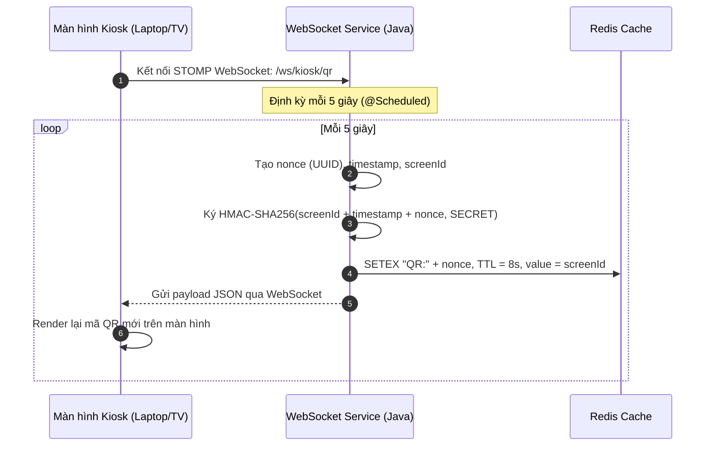
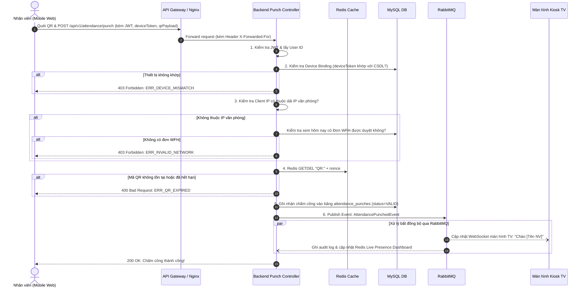
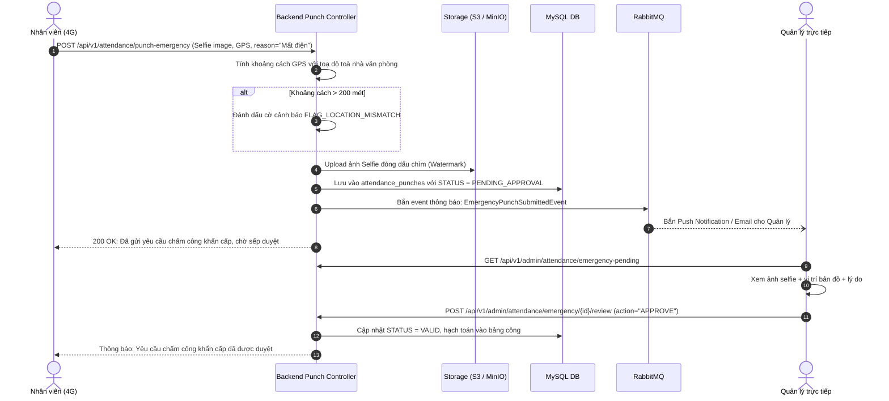
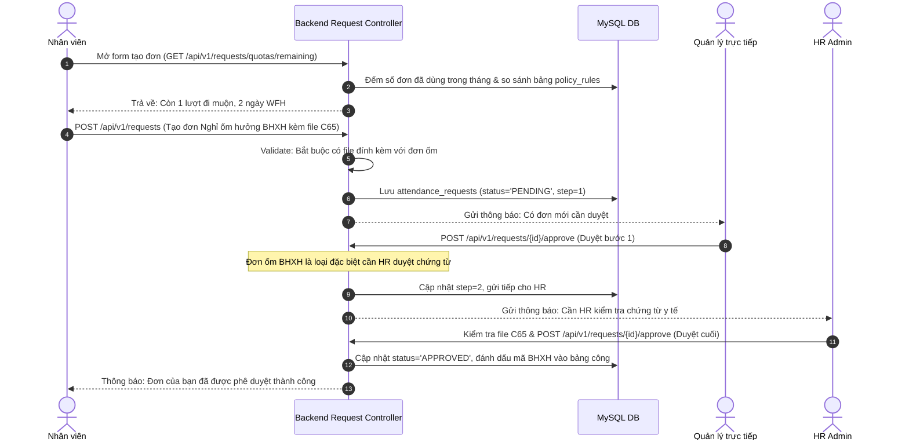
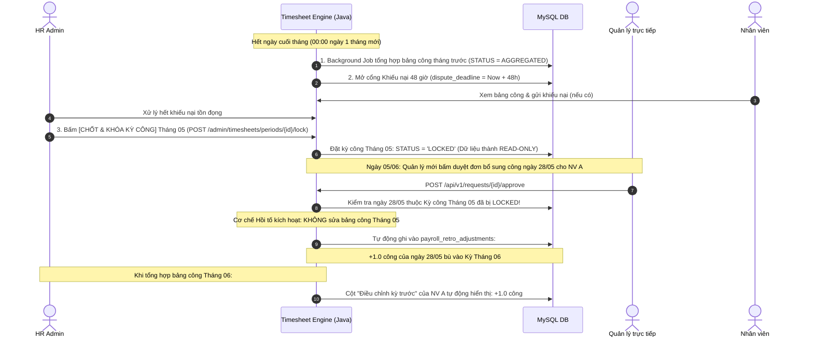

# TÀI LIỆU KỸ THUẬT 02: THIẾT KẾ TOÀN BỘ API ENDPOINTS & FLOW NGHIỆP VỤ
## Chuẩn thiết kế: RESTful API (JSON) + WebSocket STOMP + OAuth2 Keycloak JWT
Thư mục: `docs/technicals/02_API_SPECIFICATION_AND_FLOWS.md`

---

## 1. TIÊU CHUẨN THIẾT KẾ API
* **Base URL:** `https://api.chamcong.congty.com/api/v1`
* **Xác thực:** Header `Authorization: Bearer <Keycloak_Access_Token>`
* **Mã định dạng trả về chuẩn (Standard Response Envelope):**
  ```json
  {
    "success": true,
    "code": "SUCCESS",
    "message": "Thao tác thành công",
    "data": {},
    "timestamp": "2026-05-15T08:30:00Z"
  }
  ```
* **Mã lỗi chuẩn khi có sự cố:**
  ```json
  {
    "success": false,
    "code": "ERR_INVALID_NETWORK",
    "message": "Vui lòng kết nối vào mạng Wi-Fi công ty để thực hiện chấm công.",
    "errors": [],
    "timestamp": "2026-05-15T08:30:00Z"
  }
  ```

---

## 2. DANH MỤC API ENDPOINTS CHI TIẾT THEO MODULE

### Module A: Xác thực & Khóa Thiết bị (Auth & Device Binding)

| Method | Endpoint | Quyền (Role) | Mô tả nghiệp vụ |
| :--- | :--- | :--- | :--- |
| `GET` | `/auth/me` | All Authenticated | Lấy profile nhân viên, phòng ban, thông tin sếp trực tiếp và vai trò trong app |
| `POST`| `/devices/enroll` | All Authenticated | Đăng ký thiết bị chấm công lần đầu (gửi Fingerprint + Device Name) |
| `GET` | `/devices/my-device` | All Authenticated | Kiểm tra trạng thái thiết bị của nhân viên hiện tại (`ACTIVE`, `REVOKED`) |
| `POST`| `/devices/request-change` | All Authenticated | Gửi yêu cầu đổi thiết bị mới cho HR duyệt (khi mua máy mới) |
| `GET` | `/admin/devices/pending` | `HR_ADMIN` | Danh sách yêu cầu đổi/cấp thiết bị đang chờ duyệt |
| `POST`| `/admin/devices/{id}/approve` | `HR_ADMIN` | Duyệt kích hoạt thiết bị mới, hủy thiết bị cũ |

---

### Module B: Ghi nhận Chấm công (Attendance & Kiosk)

| Method | Endpoint | Quyền (Role) | Mô tả nghiệp vụ |
| :--- | :--- | :--- | :--- |
| `WS` | `/ws/kiosk/qr` | Kiosk Client | WebSocket định kỳ nhận payload Dynamic QR code (5 giây/lần) |
| `POST`| `/attendance/punch` | All Authenticated | **Chấm công chính:** Gửi mã QR quét được + `deviceToken` + kiểm tra IP |
| `POST`| `/attendance/punch-emergency` | All Authenticated | **Chấm công dự phòng:** Multipart/form-data upload ảnh selfie, GPS, lý do |
| `GET` | `/attendance/today` | All Authenticated | Lấy lịch sử các lần chấm công trong ngày của bản thân |
| `GET` | `/attendance/history` | All Authenticated | Lấy lịch sử chấm công theo khoảng ngày (from_date, to_date) |
| `GET` | `/admin/attendance/emergency-pending` | `MANAGER`, `HR_ADMIN` | Danh sách các ca chấm công selfie khẩn cấp cần phê duyệt |
| `POST`| `/admin/attendance/emergency/{id}/review` | `MANAGER`, `HR_ADMIN` | Duyệt / Từ chối ca chấm công khẩn cấp |

#### Chi tiết Payload: `POST /api/v1/attendance/punch`
```json
// Request Body
{
  "qrPayload": "OFFICE_HQ_FLOOR_2|1731514800|a1b2c3d4-e5f6-7890-abcd-ef1234567890|SIGNATURE_HASH",
  "deviceToken": "FP_abc123_SECURE_UUID_xyz789",
  "punchType": "IN" // "IN" hoặc "OUT"
}

// Response Body (200 OK)
{
  "success": true,
  "code": "PUNCH_SUCCESS",
  "message": "Chấm công vào ca thành công lúc 08:28:15",
  "data": {
    "punchId": "c8d4e5f6-...",
    "punchTime": "2026-05-15T08:28:15Z",
    "punchType": "IN",
    "method": "DYNAMIC_QR",
    "employeeName": "Nguyễn Văn A"
  }
}
```

---

### Module C: Quản lý Đơn từ & Phê duyệt (Requests & Approvals)

| Method | Endpoint | Quyền (Role) | Mô tả nghiệp vụ |
| :--- | :--- | :--- | :--- |
| `GET` | `/requests/quotas/remaining` | All Authenticated | Lấy số lượt đi muộn còn lại, số ngày WFH còn lại trong tháng của cá nhân |
| `POST`| `/requests` | All Authenticated | Tạo đơn mới (Đi muộn/sớm, Bổ sung công, WFH, Phép năm, Nghỉ BHXH...) |
| `GET` | `/requests/my-requests` | All Authenticated | Danh sách đơn cá nhân đã gửi (lọc theo trạng thái, loại đơn) |
| `DELETE`| `/requests/{id}` | All Authenticated | Hủy đơn đang ở trạng thái `PENDING` |
| `GET` | `/requests/pending-approvals` | `MANAGER`, `HR_ADMIN` | Danh sách đơn của cấp dưới đang chờ mình phê duyệt |
| `POST`| `/requests/{id}/approve` | `MANAGER`, `HR_ADMIN` | Phê duyệt đơn (tự động cập nhật công hoặc chuyển HR bước 2) |
| `POST`| `/requests/{id}/reject` | `MANAGER`, `HR_ADMIN` | Từ chối đơn (bắt buộc truyền `reason`) |
| `POST`| `/requests/{id}/eod-report` | All Authenticated | Nộp báo cáo tóm tắt công việc cuối ngày cho ngày WFH |

#### Chi tiết Payload: `POST /api/v1/requests` (Tạo Đơn Đi muộn)
```json
// Request Body
{
  "requestType": "LATE_IN",
  "fromDate": "2026-05-18",
  "toDate": "2026-05-18",
  "durationMinutes": 45,
  "reason": "Xe bị hỏng giữa đường, vào muộn 45 phút"
}
```

---

### Module D: Giám sát Trực tiếp & Lịch nhóm (Live Monitoring & Calendar)

| Method | Endpoint | Quyền (Role) | Mô tả nghiệp vụ |
| :--- | :--- | :--- | :--- |
| `GET` | `/team/live-dashboard` | `MANAGER`, `HR_ADMIN` | Trạng thái thời gian thực hôm nay của team: Ai có mặt, WFH, Nghỉ phép, Đi muộn |
| `GET` | `/team/calendar` | `MANAGER`, `HR_ADMIN` | Lịch trình vắng mặt/WFH dạng ma trận tuần/tháng của toàn bộ thành viên trong đội |

---

### Module E: Cấu hình Luật, Ca làm việc & Phòng ban (Admin & HR)

| Method | Endpoint | Quyền (Role) | Mô tả nghiệp vụ |
| :--- | :--- | :--- | :--- |
| `GET/POST` | `/admin/departments` | `HR_ADMIN` | Quản lý cây phòng ban đa cấp, bổ nhiệm trưởng phòng |
| `GET/POST` | `/admin/employees` | `HR_ADMIN` | Quản lý hồ sơ nhân viên, loại hợp đồng, sếp trực tiếp |
| `GET/POST` | `/admin/shifts` | `HR_ADMIN` | Quản lý danh mục ca làm việc (cố định, linh hoạt, ca gãy) |
| `POST` | `/admin/shifts/assign` | `HR_ADMIN` | Gán ca làm việc cho phòng ban hoặc nhân viên cụ thể |
| `GET/POST` | `/admin/holidays` | `HR_ADMIN` | Quản lý danh mục ngày nghỉ lễ, ngày nghỉ bù hằng năm |
| `GET/POST` | `/admin/policies` | `HR_ADMIN` | Cấu hình quy tắc hạn ngạch có ngày hiệu lực (`effective_from`) |

---

### Module F: Bảng công, Khiếu nại 48h & Chốt kỳ lương (Timesheet & Closing)

| Method | Endpoint | Quyền (Role) | Mô tả nghiệp vụ |
| :--- | :--- | :--- | :--- |
| `GET` | `/timesheets/my-timesheet` | All Authenticated | Xem bảng công chi tiết cá nhân theo tháng (kèm trạng thái mở/khóa) |
| `POST`| `/timesheets/disputes` | All Authenticated | Gửi khiếu nại công trong khung 48h sau khi hết kỳ công |
| `GET` | `/admin/timesheets/periods` | `HR_ADMIN` | Quản lý danh sách các kỳ công tháng (Open, Aggregated, Locked) |
| `POST`| `/admin/timesheets/periods/{id}/aggregate` | `HR_ADMIN` | Kích hoạt tính toán/tổng hợp lại bảng công tháng |
| `GET` | `/admin/timesheets/periods/{id}/disputes` | `HR_ADMIN` | Danh sách khiếu nại của nhân viên cần xử lý |
| `POST`| `/admin/timesheets/disputes/{id}/resolve`| `HR_ADMIN` | Xử lý khiếu nại: Chấp nhận sửa công hoặc Bác bỏ |
| `POST`| `/admin/timesheets/periods/{id}/lock` | `HR_ADMIN` | **Khóa bất biến kỳ công** (Chuyển bảng công sang `LOCKED`) |
| `GET` | `/admin/timesheets/periods/{id}/export` | `HR_ADMIN` | Xuất file Excel bảng công chuẩn gửi phòng Kế toán tính lương |

---

## 3. CƠ CHẾ FLOW NGHIỆP VỤ (SEQUENCE FLOW DIAGRAMS)

### Flow 1: Chu kỳ Sinh & Đồng bộ Dynamic QR Code qua WebSocket



---

### Flow 2: Chấm công Chuẩn (Multi-Factor Verification: Dynamic QR + IP + Device)



---

### Flow 3: Chấm công Khẩn cấp (Emergency Fallback khi mất điện/mất mạng)



---

### Flow 4: Kiểm soát Hạn ngạch (Quota) khi Tạo đơn & Phê duyệt Đa cấp



---

### Flow 5: Quy trình Khóa Kỳ công & Cơ chế Điều chỉnh Hồi tố kỳ sau (Retroactive)



