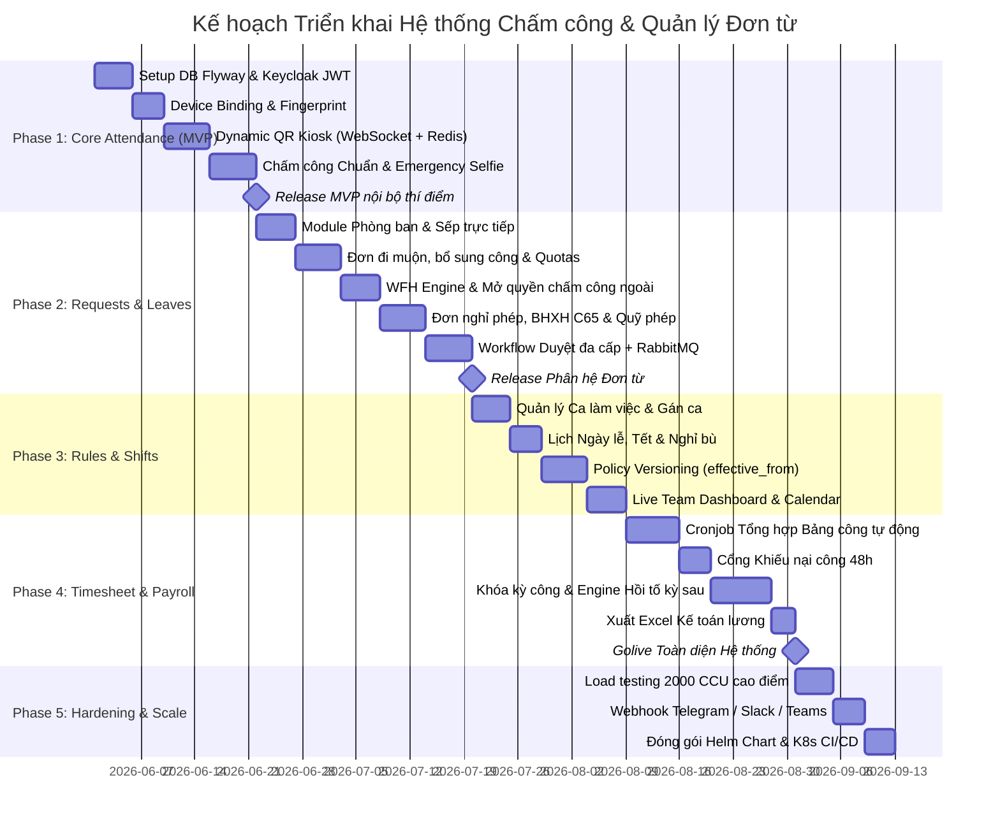

# TÀI LIỆU KỸ THUẬT 03: KẾ HOẠCH TRIỂN KHAI THEO GIAI ĐOẠN (ROADMAP & PHASING)
## Phân loại theo Mức độ Ưu tiên (Priority) & Độ phức tạp (Complexity)
Thư mục: `docs/technicals/03_IMPLEMENTATION_ROADMAP_AND_PHASING.md`

---

## 1. MA TRẬN ĐÁNH GIÁ ĐỘ ƯU TIÊN & ĐỘ PHỨC TẠP

| Tính năng / Module | Độ ưu tiên nghiệp vụ | Độ phức tạp kỹ thuật | Giai đoạn triển khai |
| :--- | :---: | :---: | :---: |
| **Tích hợp Keycloak SSO & Xác thực JWT** | **P0 (Bắt buộc)** | Thấp - Trung bình | **Phase 1** |
| **Khóa thiết bị chấm công (Device Binding)** | **P0 (Bắt buộc)** | Trung bình | **Phase 1** |
| **Dynamic QR Code (WebSocket + Redis)** | **P0 (Bắt buộc)** | Trung bình | **Phase 1** |
| **Chấm công Khẩn cấp (Selfie Fallback + GPS)** | **P0 (Bắt buộc)** | Trung bình | **Phase 1** |
| **Cơ cấu tổ chức & Cây phòng ban (MySQL)** | **P0 (Bắt buộc)** | Trung bình | **Phase 2** |
| **Đơn Đi muộn / Về sớm / Bổ sung công** | **P0 (Bắt buộc)** | Trung bình | **Phase 2** |
| **Đơn WFH & Chấm công linh hoạt ngoài mạng** | **P0 (Bắt buộc)** | Trung bình - Cao | **Phase 2** |
| **Đơn Nghỉ phép & Upload chứng từ y tế BHXH** | **P0 (Bắt buộc)** | Trung bình | **Phase 2** |
| **Luồng Phê duyệt Đa cấp & Thông báo RabbitMQ**| **P0 (Bắt buộc)** | Cao | **Phase 2** |
| **Quản lý Ca làm việc & Lịch Ngày lễ năm** | **P1 (Quan trọng)**| Trung bình | **Phase 3** |
| **Engine Quản lý Luật có Ngày hiệu lực** | **P1 (Quan trọng)**| Cao | **Phase 3** |
| **Live Team Dashboard & Lịch nhóm trực quan** | **P1 (Quan trọng)**| Trung bình | **Phase 3** |
| **Tổng hợp Bảng công tự động cuối tháng** | **P0 (Sống còn)** | Rất cao | **Phase 4** |
| **Cổng Khiếu nại công 48h (Dispute Window)** | **P0 (Sống còn)** | Trung bình | **Phase 4** |
| **Khóa kỳ công & Cơ chế Hồi tố kỳ sau (Retro)** | **P0 (Sống còn)** | Rất cao | **Phase 4** |
| **Xuất Excel Bảng công chuẩn Kế toán** | **P0 (Sống còn)** | Thấp | **Phase 4** |
| **Tối ưu Virtual Threads & Load Test 2000 CCU** | **P2 (Nâng cao)** | Cao | **Phase 5** |
| **Tích hợp Webhook Chat (Telegram/Slack/Teams)**| **P2 (Nâng cao)** | Thấp | **Phase 5** |

---

## 2. KẾ HOẠCH TRIỂN KHAI 5 GIAI ĐOẠN CHI TIẾT

---

### GIAI ĐOẠN 1: NỀN TẢNG CHẤM CÔNG & CHỐNG GIAN LẬN (MVP)
* **Thời lượng dự kiến:** 3 tuần
* **Mục tiêu:** Cung cấp ngay chức năng chấm công cơ bản tại văn phòng để thay thế máy chấm công vân tay cũ.
* **Các đầu việc cụ thể:**
  1. **Khởi tạo hạ tầng:**
     * Thiết lập cấu trúc dự án Spring Boot 3 + Java 21/25.
     * Cấu hình Flyway migration tạo các bảng: `employees`, `registered_devices`, `attendance_punches`.
     * Cấu hình Spring Security kết nối Keycloak Issuer (Resource Server validate JWT).
  2. **Phát triển Kiosk QR:**
     * Xây dựng WebSocket STOMP endpoint (`/ws/kiosk/qr`).
     * Background task sinh mã OTP ký HMAC-SHA256 mỗi 5 giây, lưu Redis TTL 8 giây.
     * Màn hình ReactJS Kiosk hiển thị mã QR tự xoay và chạy ở chế độ toàn màn hình.
  3. **Phát triển Check-in Mobile:**
     * Thư viện quét camera trực tiếp `html5-qrcode` trên ReactJS PWA.
     * API `/api/v1/attendance/punch`: Kiểm tra IP văn phòng, kiểm tra deviceToken, xác thực mã QR atomic trên Redis.
  4. **Cơ chế Dự phòng (Emergency Selfie):**
     * Form chụp selfie trên mobile, lấy toạ độ GPS, upload ảnh lên MinIO/S3.
     * Màn hình cho Quản lý duyệt ca chấm công khẩn cấp.
* **Tiêu chí hoàn thành (DoD):**
  * 100% nhân viên thí điểm chấm công thành công tại văn phòng qua quét QR.
  * Chặn được trường hợp dùng máy khác và chấm ngoài mạng Wi-Fi.

---

### GIAI ĐOẠN 2: PHÂN HỆ ĐƠN TỪ, QUẢN LÝ NGHỈ PHÉP & WFH
* **Thời lượng dự kiến:** 4 tuần
* **Mục tiêu:** Tự động hóa toàn bộ việc xin phép, giải trình và mở quyền chấm công WFH.
* **Các đầu việc cụ thể:**
  1. **Quản lý Tổ chức & Quản lý trực tiếp:**
     * Bảng `departments` và quan hệ `direct_manager_id` trong `employees`.
     * API lấy danh sách cấp dưới của một Quản lý.
  2. **Engine Quản lý Đơn từ & Hạn ngạch (Quota):**
     * Đơn đi muộn / về sớm: Kiểm tra quota còn lại trong tháng, kiểm tra thời lượng $\le$ 60 phút.
     * Đơn bổ sung chấm công: Chặn nộp nếu quá 3 ngày làm việc kể từ ngày sự cố.
     * Đơn WFH: Đăng ký lẻ hoặc cố định thứ 6; kiểm tra quota WFH tuần/tháng.
     * Logic chấm công WFH: Cho phép chấm công ngoài mạng khi có đơn WFH hợp lệ trong ngày.
  3. **Quản lý Nghỉ phép & Chứng từ y tế:**
     * Bảng `employee_leave_balances`: Thuật toán tích lũy phép năm + thâm niên (+1 ngày mỗi 2 năm làm việc).
     * Bắt buộc upload giấy khám/chứng từ C65 với đơn nghỉ ốm và nghỉ thai sản.
  4. **Quy trình duyệt đa cấp & Bắn thông báo:**
     * Luồng duyệt: Quản lý trực tiếp $\rightarrow$ HR Admin (với đơn nghỉ dài hoặc chế độ BHXH).
     * Tích hợp RabbitMQ để gửi thông báo tức thì (Email/Web Push) cho người duyệt và người nộp đơn.
* **Tiêu chí hoàn thành (DoD):**
  * Nhân viên tự nộp đơn và theo dõi được số lượt đi muộn / ngày phép còn lại.
  * Nhân viên WFH được duyệt có thể chấm công thành công từ nhà mà không bị lỗi mạng.

---

### GIAI ĐOẠN 3: CA LÀM VIỆC, LỊCH NGHỈ LỄ & LUẬT THEO NGÀY HIỆU LỰC
* **Thời lượng dự kiến:** 3 tuần
* **Mục tiêu:** Hoàn thiện các nghiệp vụ cấu hình động cho phòng HR.
* **Các đầu việc cụ thể:**
  1. **Quản lý Ca làm việc:**
     * Quản lý ca hành chính, ca linh hoạt (tính đủ 8 tiếng), ca gãy.
     * Giao diện phân ca theo phòng ban và theo cá nhân.
  2. **Quản lý Lịch Ngày lễ theo Năm:**
     * Danh mục ngày lễ, ngày nghỉ bù, ngày làm bù.
     * Tự động cộng ngày công hưởng nguyên lương (`L`) vào các ngày lễ.
  3. **Engine Luật có Ngày hiệu lực (`policy_rules`):**
     * Quản lý tham số quota gắn với `effective_from` và `effective_to` theo từng loại hợp đồng (Chính thức vs Thử việc).
  4. **Live Team Dashboard & Calendar:**
     * Màn hình giám sát trực tiếp hôm nay của từng team: Ai có mặt, WFH, nghỉ phép, đi muộn.
     * Lịch dùng chung (Team Shared Calendar) hiển thị lịch trình tuần/tháng của đội nhóm.
* **Tiêu chí hoàn thành (DoD):**
  * HR tự thay đổi luật mà không cần can thiệp vào mã nguồn backend.
  * Trưởng nhóm nhìn rõ lịch nghỉ của cả nhóm trước khi bấm duyệt đơn.

---

### GIAI ĐOẠN 4: TỔNG HỢP CÔNG, KHIẾU NẠI 48H, KHÓA CÔNG & HỒI TỐ KỲ SAU
* **Thời lượng dự kiến:** 3.5 tuần
* **Mục tiêu:** Đảm bảo độ chính xác tuyệt đối của dữ liệu trước khi chuyển sang tính lương.
* **Các đầu việc cụ thể:**
  1. **Background Job Tổng hợp Bảng công:**
     * Tự động chạy lúc 00:00 ngày đầu tháng để tính toán công chuẩn, công thực tế, số phút đi trễ, ngày phép, ngày BHXH.
  2. **Cổng Khiếu nại công 48h (Dispute Window):**
     * Mở quyền khiếu nại trong 48 giờ sau khi kỳ công kết thúc.
     * Giao diện cho nhân viên phản ánh ngày công sai kèm bằng chứng; giao diện HR xử lý khiếu nại.
  3. **Khóa kỳ công bất biến (Data Locking):**
     * HR bấm [Chốt & Khóa kỳ công] $\rightarrow$ Toàn bộ dữ liệu kỳ đó chuyển sang `LOCKED` (Read-only vĩnh viễn).
  4. **Engine Hồi tố kỳ sau (Retroactive Adjustment Engine):**
     * Xử lý trường hợp đơn duyệt muộn sau khi đã khóa công: Tự động sinh bản ghi trong `payroll_retro_adjustments` để cộng/trừ vào bảng công kỳ kế tiếp.
  5. **Xuất báo cáo lương:**
     * Xuất file Excel chuẩn format theo quy định của phòng Kế toán.
* **Tiêu chí hoàn thành (DoD):**
  * Bảng công chốt khóa không thể bị sửa đổi.
  * Mọi đơn duyệt muộn đều được chuyển chính xác sang cột điều chỉnh của tháng sau.

---

### GIAI ĐOẠN 5: TỐI ƯU HIỆU NĂNG, TÍCH HỢP HẠ TẦNG & GOLIVE
* **Thời lượng dự kiến:** 2 tuần
* **Mục tiêu:** Kiểm thử chịu tải cao điểm và đóng gói hoàn thiện vào CI/CD công ty.
* **Các đầu việc cụ thể:**
  1. **Tối ưu Chịu tải Cao điểm (Peak Load Tuning):**
     * Bật Virtual Threads trên Java 21/25 (`spring.threads.virtual.enabled=true`).
     * Cấu hình HikariCP Connection Pool (Max connections: 50, Timeout: 5000ms).
     * Kiểm thử tải với công cụ k6 / JMeter: Giả lập 2.000 nhân viên check-in đồng thời trong vòng 5 phút (8h55 - 9h00) $\rightarrow$ Đảm bảo response time < 100ms, tỷ lệ lỗi 0%.
  2. **Tích hợp Webhook Kênh Chat:**
     * Bắn thông báo duyệt đơn tức thì qua Bot Telegram / Slack / Microsoft Teams / Zalo ZNS.
  3. **Tích hợp Hạ tầng CI/CD:**
     * Viết file `Dockerfile` tối ưu multi-stage build cho Spring Boot và ReactJS.
     * Viết file Helm Chart / Kubernetes Manifests (Deployment, Service, Ingress, HPA tự động co giãn pod).
* **Tiêu chí hoàn thành (DoD):**
  * Hệ thống vận hành trơn tru trên môi trường Production, bàn giao đầy đủ cho HR và Kế toán.

